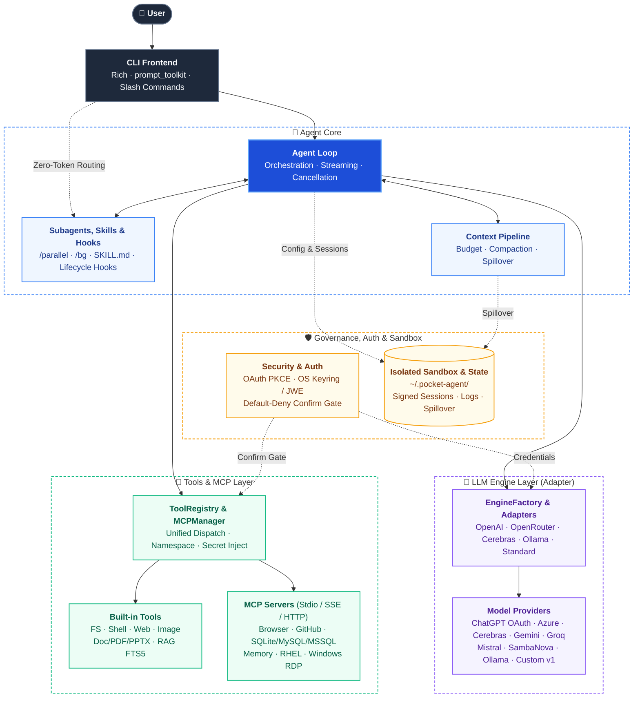

# PocketAgent 🤖

[](https://github.com/zanta0529/pocket-agent/releases/latest)
[](https://github.com/zanta0529/pocket-agent/actions/workflows/standard-ci.yml?query=branch%3Amain)
[](https://www.python.org/)
[](#system-requirements)
[](LICENSE)

**Language**: [English](README.md) | [繁體中文](README.zh-TW.md)

## 📖 Introduction

**PocketAgent** is a local-first Python AI agent with enterprise-grade extensibility and security, offering a minimal, fast, developer-focused CLI experience.

Its key advantage is **OAuth PKCE authentication directly integrated with the ChatGPT backend (Codex API)** — if you have a ChatGPT Plus or Pro subscription, you can leverage advanced models and deep reasoning without needing or consuming an OpenAI API Key billing balance. It also seamlessly supports **OpenRouter API**, **Gemini (Google AI Studio)** (both API Key and Google OAuth), cloud inference platforms with free developer tiers (**Cerebras Cloud**, **Groq Cloud**, **SambaNova Cloud**, **Mistral AI**), as well as local **Ollama** and **Ollama Cloud** for privacy-sensitive offline or hybrid workflows.

> ⚠️ **Important Disclaimer**: This tool (including the core agent and all built-in/external MCP servers) can execute local shell commands, read/write files, and interact with remote hosts and browsers, while LLM outputs are non-deterministic. Users must review every operation and assume all risks; any unintended behavior or resulting damage has no relation to the original author(s). Please read the full [Disclaimer](#️-disclaimer) section before use.

### 📑 Table of Contents

- [🚀 Installation & First Run](#-installation--first-run)
  - [Option A: Windows Modern Portable [Recommended for General Users]](#option-a-windows-modern-portable-recommended-for-general-users)
  - [Option B: Cross-Platform One-Click Launchers [Recommended for Quick Tryout]](#option-b-cross-platform-one-click-launchers-recommended-for-quick-tryout)
  - [Option C: Manual Developer Installation [Recommended for Development]](#option-c-manual-developer-installation-recommended-for-development)
  - [First-Time Setup](#first-time-setup)
- [💻 Quick Start & Usage](#-quick-start--usage)
  - [Terminal Shortcuts](#terminal-shortcuts)
  - [Core Slash Commands](#core-slash-commands)
- [✨ Architecture & Features](#-architecture--features)
  - [1. LLM Engine Adapter Architecture](#1-llm-engine-adapter-architecture)
  - [2. Native Document Generation](#2-native-document-generation)
  - [3. Extensibility & Multi-Agent](#3-extensibility--multi-agent)
  - [4. Enterprise Governance & Zero Project Pollution](#4-enterprise-governance--zero-project-pollution)
  - [5. Deep Dive Documentation](#5-deep-dive-documentation)
- [⚙️ Configuration & Customization](#️-configuration--customization)
  - [Global Configuration (`config.json`)](#global-configuration-configjson)
  - [Layered Instructions & Workspace Rules (`AGENTS.md`)](#layered-instructions--workspace-rules-agentsmd)
  - [External MCP Server Mounting & Injection](#external-mcp-server-mounting--injection)
- [🛠️ Development & Contributing](#️-development--contributing)
- [📦 Build & Deployment](#-build--deployment)
- [⚠️ Disclaimer](#️-disclaimer)
- [📜 License](#-license)

---

## 🚀 Installation & First Run

### System Requirements

- **Python 3.14 or higher** (not required on the host if using Option A: Modern Portable).
- Supported OS: Windows 10/11, macOS (Apple Silicon / Intel), Linux (Ubuntu, Debian, RHEL, etc.).

---

### Option A: Windows Modern Portable [Recommended for General Users]

Ideal for Windows users or enterprise environments where global Python installation is restricted or strict antivirus policies are enforced:

1. Download the latest [**`PocketAgent-portable.zip`**](https://github.com/zanta0529/pocket-agent/releases/latest/download/PocketAgent-portable.zip) directly (or visit [**GitHub Releases**](https://github.com/zanta0529/pocket-agent/releases)).
2. Extract it to any folder (e.g., `D:\PocketAgent`).
3. Open the extracted folder and double-click **`pocket.bat`** to launch immediately!

> 💡 **Portable Highlights**: Bundles an officially signed standalone Python runtime and all dependencies without polluting system Python or triggering false positives from unsigned `.exe` binaries. You can update in-place via `/update` inside the CLI.

---

### Option B: Cross-Platform One-Click Launchers [Recommended for Quick Tryout]

The repository includes bootstrap launchers for each OS that automatically detect Python, create an isolated `venv`, install dependencies, and start the agent:

```bash
# 1. Clone the repository
git clone https://github.com/zanta0529/pocket-agent.git
cd pocket-agent
```

Run the launcher for your OS:

- **🪟 Windows (CMD)**:

  ```cmd
  run.bat
  ```

- **🐧 Linux (Terminal)**:

  ```bash
  chmod +x run.sh
  ./run.sh
  ```

- **🍎 macOS (Terminal or Finder)**:

  ```bash
  chmod +x run.command
  ./run.command
  ```

---

### Option C: Manual Developer Installation [Recommended for Development]

If you prefer managing the virtual environment manually or registering `pocket-agent` globally:

```bash
# 1. Clone and enter the repository
git clone https://github.com/zanta0529/pocket-agent.git
cd pocket-agent

# 2. Create and activate a Python 3.14+ virtual environment
python -m venv venv
# Linux / macOS:
source venv/bin/activate
# Windows (CMD):
venv\Scripts\activate.bat

# 3. Upgrade pip and install runtime dependencies
pip install --upgrade pip
pip install -r requirements.txt

# 4. Install in editable mode
pip install -e .
```

Once installed, you can run `pocket-agent` directly from your terminal.

---

### First-Time Setup

Regardless of installation method, **run the setup wizard on first use** to configure your language, model provider, and credentials (saved to `~/.pocket-agent/config.json`):

```bash
# If using manual installation (Option C)
pocket-agent setup

# If using one-click launchers (Option B)
run.bat setup       # Windows
./run.sh setup      # Linux
./run.command setup # macOS
```

The interactive wizard guides you through five steps (defaults to English if `locale` is not yet configured in `config.json`, or uses the configured locale):

1. **Select Language**:
   - Dynamically lists available locales under `locales/` (e.g., `en_US`, `zh_TW`), writes your selection to `config.json`, and immediately switches the remaining wizard steps to that language.
2. **Select Service Provider & Login**:
   - **ChatGPT Plus/Pro (OpenAI OAuth PKCE)**: _No API key needed_ — opens your browser to authorize and automatically returns the token to `http://localhost:1455`.
   - **Gemini (Google AI Studio)**: Supports Google OAuth browser login or `GEMINI_API_KEY`.
   - **Cloud Inference (Azure OpenAI / AI Foundry / Cerebras / OpenRouter / Groq / SambaNova / Mistral / Ollama Cloud)**: Enter your API Key (protected via OS Keyring or JWE encrypted vault; Cerebras also allows customizing its Base URL).
   - **Local Models (Ollama)**: Connects to `http://localhost:11434` by default, supporting offline execution.
   - **OpenAI-Compatible (Local / Gateway)**: Connect to LM Studio, vLLM, llama.cpp, or an internal enterprise AI gateway (custom Base URL with optional API Key; include `/v1` in the URL when required. For unauthenticated Ollama, prefer **Ollama (Local)** for automatic context-window detection).
3. **Select Default Model**:
   - Attempts to fetch available models dynamically from the provider, with support for custom model names.
4. **Optional External MCP Tools**:
   - Prompts whether to configure external Stdio / SSE / Streamable HTTP MCP servers (can be skipped and configured later).
5. **Launch Agent**:
   - Run `pocket-agent` (or `run.bat` / `./run.sh`) to start chatting!

---

## 💻 Quick Start & Usage

Once started, the CLI displays an interactive conversation prompt with a live bottom toolbar showing the active model, reasoning effort, pending attachments, and cumulative token usage; when background subagents are running or ready to collect, a second highlighted status line automatically appears with live progress and collection hints.

### Terminal Shortcuts

| Key Combination                 | Description                                                                                              |
| :------------------------------ | :------------------------------------------------------------------------------------------------------- |
| **Enter**                       | Submit current input.                                                                                    |
| **Esc then Enter** (Meta+Enter) | Insert a newline (multi-line paste is also preserved in the buffer).                                     |
| **Alt+V**                       | Smart clipboard paste: supports files selected in Explorer, text paths, and **in-memory screenshots**.   |
| **Tab / Arrow Keys**            | Auto-complete commands/paths and navigate interactive selection menus.                                   |
| **Ctrl+L**                      | Clear terminal screen while preserving conversation history.                                             |
| **Ctrl+C**                      | While typing: clear input buffer (keeps attachments); during execution: interrupt active foreground agent/subagent (does not cancel `/bg` jobs; use `/jobs cancel`). |
| **Ctrl+D** or `/exit`           | Safely close and exit the application.                                                                   |

---

### Core Slash Commands

Type any of the following `/` commands at the prompt:

#### 🤖 Model & Session Management

- `/model`: Open an interactive selector to switch providers and models (`openai`, `gemini`, `openrouter`, `azure`, `cerebras`, `groq`, `sambanova`, `mistral`, `ollama`, `ollamacloud`, `openai-compatible`).
- `/reasoning [auto|high|medium|low|none]` (or `/effort`): Adjust LLM reasoning effort on the fly (defaults to `auto`; opens an interactive menu when called without arguments).
- `/session`: Open a paginated interactive session manager to browse, load, or delete saved conversations.
- `/prune [<days> | --keep <count>]` (or `/session prune`): Clean up expired or excess session history (defaults to older than 30 days or keeping latest 20; protects active session and requires confirmation).
- `/new`: Start a clean new conversation (auto-saves the previous session and resets context, attachments, and counters).
- `/rename <new_title>`: Rename the current session title for easier identification in `/session`.
- `/resume` (CLI flag): Run `pocket-agent --resume` to automatically resume the most recent session at startup.
- `/compact`: Summarize and compact middle conversation history to reclaim context window space.
- `/clear`: Clear in-memory conversation history while keeping pending attachments and Session ID.
- `/usage` (or `/quota`): Display cumulative token usage, context window status, and provider quota (when supported).

#### 📂 Files, Workspace & Context

- `/file <path>`: Add a local file (text, code, PDF, etc.) to pending attachments. Inline `@filename` references are also supported.
- `/image <prompt>`: Generate an image (automatically switches to image-to-image / edit mode if image attachments are queued).
- `/code-search <query>` (or `/cs`): Search workspace code via local SQLite FTS5 and inject matching snippets into context.
- `/add-dir <path>`: Authorize and add an extra workspace directory for the current session.
- `/rm-dir [path]`: Remove an extra authorized directory (interactive menu if omitted).
- `/attachments`: List currently queued pending attachments.
- `/rm-file [index_or_path]`: Remove a pending attachment from the queue without deleting the file on disk.
- `/undo`: Inspect unified diffs of AI-modified file backups and restore interactively.

#### 👥 Subagents & Custom Skills

- `/subagent <name> <task>` or `/<name> <task>`: **Zero-Token Routing** — intercepts at the CLI layer and dispatches directly in the **foreground** to the named subagent without main-agent LLM overhead (e.g., `/researcher gather competitor info`).
- `/parallel <name:task> | <name:task>`: Run multiple subagents in parallel in the foreground (Map) and automatically synthesize their reports into one final summary (Reduce). _Separate tasks with `|`_.
- `/bg <name> <task>`: **Non-blocking Background Subagent** — launches a strictly read-only subagent in the background (up to 3 concurrent jobs) and immediately returns the prompt so you can keep chatting.
- `/jobs [list | all | show <id> | collect [id] | cancel <id|all> | clear]`: Manage background subagent jobs; defaults to active/uncollected jobs (`all` shows full history, `show` previews results without spending main-context tokens, `collect` injects completed reports into main conversation history, and `clear` removes finished records).
- `/skills [name]`: List all available global and workspace skills, or view a specific skill's SOP.
- `/learn`: Analyze recent conversation context and interactively extract a reusable skill.

#### 🔧 System Settings & Maintenance

- `/config`: Launch the interactive global configuration editor (`locale` provides a live selector of available languages).
- `/clean`: Manually trigger Housekeeping to clean expired logs, temporary screenshots, and spillover files.
- `/update`: Check and apply the latest GitHub release update with auto-save and restart (Modern Portable only).
- `/logout`: Clear locally stored OAuth credentials.

> 💡 For path resolution rules, image-generation details, and system boundaries, see: [CLI Usage & Limitations](docs/guides/cli-usage-limitations.md).

---

## ✨ Architecture & Features



> User prompts enter through the CLI frontend into the Agent Core, where the Context Pipeline manages token budgets while dispatching requests across LLM Engine Adapters, Built-in Tools, and MCP Servers (with `/<name>` shortcuts routing directly to subagents at zero main-agent token cost). Sensitive tool calls pass through the default-deny confirmation gate, credentials stay protected in the OS Keyring or JWE vault, and all runtime logs, sessions, and spillover files remain isolated under `~/.pocket-agent/`.

### 1. LLM Engine Adapter Architecture

- **OpenAI Core / OpenRouter Compatible**: Native support for ChatGPT Plus/Pro protocols and OpenRouter, with full Function Calling and reasoning integration.
- **Ollama Chat Completions**: Adapter pattern with a built-in `<think>` tag state-machine parser so local reasoning models (e.g., DeepSeek-R1) stream thoughts cleanly with accurate token accounting.
- **Dynamic Switching**: Switch providers and models mid-session in seconds using `/model`.

### 2. Native Document Generation

- **Automated Document Formatting**: Built-in `create_docx`, `create_pdf`, and `create_pptx` tools with zero external web dependencies.
- **Seamless Export**: Generate structured Word reports, PDF documentation, or PowerPoint decks directly from natural language instructions.

### 3. Extensibility & Multi-Agent

[](docs/architecture/mcp-architecture.md)

- **Subagents & Background Multitasking**: Define specialized personas (e.g., researcher, architect, auditor) and run them across **four execution modes** — foreground single (`/<name>`, `run_subagent`), foreground parallel (`/parallel`, `run_subagents_parallel`), LLM-controlled background (`start_background_subagent` / `check_background_subagent`), and CLI-controlled background (`/bg` / `/jobs`). Background jobs run with strict read-only isolation without blocking foreground chat and feature a **preview-before-inject** workflow (`/jobs show` lets you read reports with zero ongoing main-context token overhead, while `/jobs collect` injects them into conversation history when you want the main agent to take over), surfaced via a live two-line status bar, non-intrusive completion notices, and a reply footer badge; see [Routing, Layered Config & Subagents](docs/architecture/routing-and-subagents.md) for the full mode comparison.
- **Hooks**: Attach local Python scripts to `before_send`, `after_response`, `before_tool`, and `after_tool` lifecycle events.
- **MCP (Model Context Protocol)**: Full support for Stdio, SSE, and Streamable HTTP. You can flexibly toggle which servers load at startup via `enabled: true/false` in `mcp_config.yaml` (defaults to `true` when omitted) without commenting out configurations. Bundled MCP servers include:
  - `browser_mcp.py`: Pure-Python browser automation driving system Edge/Chrome with CDP and session reuse.
  - `github_mcp.py`: GitHub Issue / PR / Diff / Review / CI inspection, template-aware PR creation, and commenting.
  - `sqlite_mcp.py` / `mysql_mcp.py` / `mssql_mcp.py`: Read-only schema inspection and querying for local and remote databases.
  - `memory_mcp.py`: Local JSON-based cross-session long-term memory search.
  - `rhel_mcp.py`: Structured read-only SSH diagnostics and log inspection for remote RHEL hosts.
  - `win_rdp_mcp.py`: Remote Windows RDP (Port 3389) visual control and read-only inspection.
  - `netdiag_mcp.py`: Opt-in, confirmation-gated staged website and network escalation diagnostics (`DNS -> TCP -> TLS -> HTTP` and multi-resolver DNS comparison).
- **CLI Dynamic Shortcuts (Zero-Token Routing)**: Invoke `/<name>` to dispatch directly to a subagent without main-agent token consumption.
- **Published Skills (Agensi Marketplace)**: PocketAgent natively follows the open `SKILL.md` specification—allowing reusable skills to work seamlessly across PocketAgent and other major AI coding agents (such as Claude Code, Cursor, and Codex-style workflows) without lock-in. The two reference skills below serve as drop-in examples demonstrating how PocketAgent handles both disciplined coding and technical presentation delivery:
  - [Plan-Build-Verify — Safe AI Coding with Approval & TDD](https://agensi.io/skills/plan-build-verify)
  - [Reveal.js Presentation — From Notes to HTML Slides](https://agensi.io/skills/reveal-js-presentation-from-notes-to-html-slides)

### 4. Enterprise Governance & Zero Project Pollution

- **CLI Execution Confirmation**: Prompts `[y: once | a: session | A: allowlist | c: custom | N: deny]` before executing shell commands or file writes.
- **MCP Default-Deny Policy**: External MCP tools require explicit user confirmation unless listed in `safe_read_tools`.
- **Secret Injection & Interactive Prompting**: Passwords and API keys can be entered securely at runtime (in-memory only, never logged or sent to LLM context) or masked from LLM schemas via `inject`.
- **Shell Sandbox**: Optional Docker isolation via `USE_SANDBOX=docker`.
- **Context Budget Pipeline**: Dynamically manages context window usage with tool-output spillover to disk, history compaction (`HistoryCompactor`), and old tool-output pruning.
- **Zero Project Pollution**: All runtime spillover files, screenshots, and logs are isolated under `~/.pocket-agent/workspaces/<workspace-slug>/`, keeping your repository's `git status` clean.

### 5. Deep Dive Documentation

Technical architecture and specification documents are available under `docs/`:

- **Core Architecture (`docs/architecture/`)**:
  - [Security & Auth (OAuth 2.0 PKCE + OS Keyring)](docs/architecture/security-and-auth.md)
  - [LLM Engine Adapter Architecture](docs/architecture/llm-adapter-architecture.md)
  - [Context Management Architecture (Budget & Compaction)](docs/architecture/context-management-architecture.md)
  - [Routing, Layered Config & Subagents](docs/architecture/routing-and-subagents.md)
  - [MCP Architecture & Secret Injection](docs/architecture/mcp-architecture.md)
  - [Hooks Lifecycle](docs/architecture/hooks-lifecycle.md)
  - [System Architecture Overview](docs/architecture/architecture-generated.md)
  - [Scheduled Jobs & Housekeeping](docs/architecture/scheduled-jobs-generated.md)
- **Guides (`docs/guides/`)**:
  - [Configuration Specification](docs/guides/configuration-specification.md)
  - [CLI Usage & Limitations](docs/guides/cli-usage-limitations.md)
  - [Developer Guide](docs/guides/developer-guide-generated.md)
  - [Operations Runbook](docs/guides/runbook-generated.md)
- **Research (`docs/research/`)**:
  - [Agent Workspace Isolation Report](docs/research/agent-workspace-architecture-report.md)
  - [BM25 Scoring & SQLite FTS5 Explained](docs/research/bm25-visual-explanation.md)
  - [Python Distribution Analysis (PyInstaller vs Bundled Python)](docs/research/python-distribution-analysis.md)

---

## ⚙️ Configuration & Customization

### Global Configuration (`config.json`)

The global config file lives at `~/.pocket-agent/config.json`. You can edit it manually or interactively via `/config`:

```json
{
  "active_provider": "openai",
  "active_model": "gpt-6-astra",
  "locale": "zh_TW",
  "system": {
    "max_tool_rounds": 20,
    "log_level": "WARNING",
    "use_sandbox": "none",
    "context_window": null,
    "context_reserve_output": 4096,
    "auto_update": true
  }
}
```

> For the full schema and environment variable mappings, see [Configuration Specification](docs/guides/configuration-specification.md).

---

### Layered Instructions & Workspace Rules (`AGENTS.md`)

PocketAgent merges instructions hierarchically so each project can define its own rules and skills:

```text
Load Order: Global Instructions (~/.pocket-agent/instructions.md)
            ⬇ Merged with
            Project Entry (target/AGENTS.md or .agents/AGENTS.md)
            ⬇ Skill Discovery (project skills override global skills of the same name)
            Project Skills (.agents/skills/*/SKILL.md)
```

1. **Global Instructions**: Place cross-project conventions in `~/.pocket-agent/instructions.md`.
2. **Project Entry (`AGENTS.md`)**: Place `AGENTS.md` (or `.agents/AGENTS.md`) in the project root; linked Markdown docs are expanded automatically up to `24,000` chars.
3. **Project Skills (`.agents/skills/`)**: Define project-local skills in `.agents/skills/<skill-name>/SKILL.md`.

---

### External MCP Server Mounting & Injection

Copy [`mcp_config.example.yaml`](mcp_config.example.yaml) to `mcp_config.yaml`:

- **Source / Dev Mode**: Place at repository root `mcp_config.yaml` (ignored by `.gitignore`).
- **Portable Mode**: Place at `~/.pocket-agent/mcp_config.yaml`.

```yaml
servers:
  browser:
    transport: stdio
    command: python
    args: ['mcp_servers/browser_mcp.py']

  github:
    transport: stdio
    command: python
    args: ['mcp_servers/github_mcp.py']
    safe_read_tools:
      - github_list_prs
      - github_read_issue
    env:
      GITHUB_TOKEN: '' # Leave blank to prompt securely at runtime
```

- **`safe_read_tools`**: Listed tools bypass the `[y/N]` interactive confirmation prompt.
- **Runtime Connection Prompting**: Empty or omitted credentials in `env` are prompted securely in-terminal on first use and kept in memory only.

---

## 🛠️ Development & Contributing

Contributions are welcome! Before submitting a Pull Request, please follow these guidelines:

### 1. Install Dev Dependencies

```bash
pip install -r requirements-dev.txt
```

### 2. Dependency Management

- Direct dependencies are maintained in `requirements.in` and `requirements-dev.in`.
- **Never edit** `requirements.txt` or `requirements-dev.txt` manually; regenerate them with `pip-compile`:

  ```bash
  pip-compile requirements.in
  pip-compile requirements-dev.in
  ```

### 3. Linting & Formatting

[](https://github.com/astral-sh/ruff)

This project enforces **Ruff** with a **120-character line limit**, UTF-8 encoding, and LF line endings:

```bash
# Check formatting
python -m ruff format --check .

# Check lint rules
python -m ruff check .

# Check import integrity against requirements.in
python scripts/check_imports.py src scripts
python scripts/check_imports.py tests --req requirements-dev.in
```

### 4. Run Automated Tests

```bash
# Run full test suite
python -m pytest tests/

# Run specific test file
python -m pytest tests/test_cli_flow.py
```

---

## 📦 Build & Deployment

Run the unified build script:

```cmd
build.bat
```

Select between:

1. **Modern Portable [Recommended]**: Packages an official Python runtime and all dependencies into `dist/PocketAgent-portable.zip`, avoiding antivirus false positives and supporting in-place `/update`.
2. **Legacy PyInstaller**: Compiles into a standalone executable (may trigger antivirus heuristics).

---

## ⚠️ Disclaimer

1. **Provided "AS IS" Without Warranty**: This software and all bundled or associated components (including, without limitation, the core agent engine, subagents, automation scripts, and all built-in or external MCP servers such as `browser_mcp`, `rhel_mcp`, `win_rdp_mcp`, database connectors, and local shell execution tools) are provided **"AS IS"** and **"AS AVAILABLE"**, without warranty of any kind, express or implied, including but not limited to the warranties of merchantability, fitness for a particular purpose, reliability, accuracy, or non-infringement.
2. **AI Non-Determinism & Assumption of Risk**: Large Language Models (LLMs) are inherently non-deterministic and may hallucinate, misinterpret instructions, or trigger unintended actions (including, without limitation, modifying or deleting local or remote files, altering system configurations, executing shell commands, interacting with browser sessions or remote desktops, mutating databases, or incurring third-party API usage charges). Users assume full responsibility for reviewing every permission prompt, maintaining proper backups, and running this tool solely within authorized and controlled environments.
3. **Third-Party Terms & Legal Compliance**: Users are solely responsible for ensuring that their use of this tool—including any OAuth flows, API integrations, remote host connections, or automated interactions—complies with all applicable laws, organizational security policies, and third-party Terms of Service (such as OpenAI, Google, OpenRouter, or other providers). Any account restrictions, suspensions, or policy violations resulting from the use of this software are strictly the user's own responsibility.
4. **Limitation of Liability**: To the maximum extent permitted by applicable law, in no event shall the original author(s) or contributors be liable for any direct, indirect, incidental, special, exemplary, or consequential damages (including, without limitation, data loss or corruption, security incidents, unauthorized operations, financial loss, or third-party claims) arising out of or in connection with the use, misuse, or inability to use this software or any of its built-in/external MCP tools, even if advised of the possibility of such damages. **All unintended behaviors and consequences rest solely with the user and have no relation to the original author(s).** By downloading, installing, running, or otherwise using this software, you acknowledge that you have read, understood, and agreed to this Disclaimer.

---

## 📜 License

Released under the [MIT License](LICENSE). See `LICENSE` in the repository root for details.
