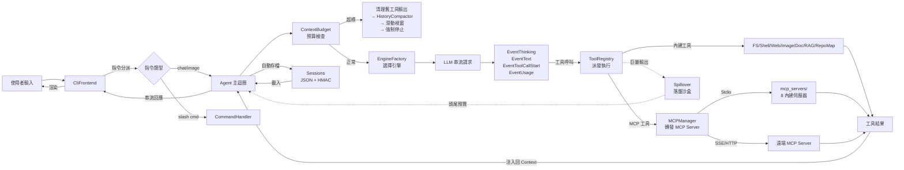

# PocketAgent 系統架構文件

> **語系說明**：本文件語系遵循使用者提問語系（預設繁體中文）。若使用者以英文提問，請切換為英文輸出。

---

## 1. 系統概覽

| 項目           | 說明                                                    |
| -------------- | ------------------------------------------------------- |
| **專案名稱**   | PocketAgent                                             |
| **版本**       | 0.1.0                                                   |
| **主要技術棧** | Python 3.14+, asyncio, Click, Rich, prompt-toolkit      |
| **架構類型**   | Background Daemon / CLI Application (Local-First AI Agent) |
| **部署環境**   | Windows 10/11, macOS (Apple Silicon / Intel), Linux (Ubuntu, Debian, RHEL, etc.) |
| **文件語系**   | zh-TW                                                   |
| **最後更新**   | 2025-01-15                                              |

---

## 2. 架構圖

```mermaid
flowchart TB
    subgraph CLI["CLI 前端層"]
        Click[Click 命令解析]
        CliFrontend[CliFrontend 策略]
        Input[CliInput 輸入處理]
        Render[CliRenderer 渲染]
        State[CliState 狀態管理]
        Commands[CliCommandRegistry 指令註冊]
        Confirm[ConfirmationBridge 確認橋接]
    end

    subgraph Core["核心業務層"]
        Agent[Agent 主迴圈]
        ToolRegistry[ToolRegistry 工具派發]
        ContextBudget[ContextBudget 預算管理]
        HistoryCompactor[HistoryCompactor 歷史壓縮]
        Spillover[Spillover 落盤機制]
        Sessions[Sessions 會話持久化]
        Subagents[Subagents 子代理]
        Cancellation[Cancellation 非同步取消]
    end

    subgraph Engines["LLM 引擎層 (Adapter Pattern)"]
        BaseEngine[BaseEngine 介面]
        OpenAIEngine[OpenAIResponsesEngine]
        OpenRouterEngine[OpenRouterEngine]
        OllamaEngine[OllamaChatEngine]
        StandardEngine[StandardChatCompletionsEngine]
        Factory[EngineFactory 工廠]
    end

    subgraph Extensions["擴充功能層"]
        MCPManager[MCPManager 伺服器管理]
        Skills[Skills 技能系統]
        Hooks[Hooks 生命週期鉤子]
        Plugins[Plugins 外掛封裝]
    end

    subgraph Tools["內建工具層"]
        FsTool[FS 原生檔案操作]
        ShellTool[Shell 命令執行]
        WebTool[Web 網路請求]
        ImageTool[Image 圖片生成]
        DocTool[Doc 文件產出]
        DocumentTool[Document 文件讀取]
        RAGTool[RAG FTS5 檢索]
        RepoMapTool[RepoMap AST 結構圖]
    end

    subgraph System["系統基礎設施層"]
        Config[Config 設定管理]
        Auth[Auth 認證 (OAuth PKCE + Keyring)]
        Paths[Paths 路徑解析]
        Constants[Constants 常數集中]
        Providers[Providers 供應商策略]
        Permissions[Permissions 指令白名單]
        Updater[Updater 線上更新]
        Wizard[Wizard 設定精靈]
    end

    subgraph MCPServers["MCP 伺服器 (Stdio)"]
        BrowserMCP[browser_mcp.py 瀏覽器自動化]
        GitHubMCP[github_mcp.py GitHub 整合]
        SQLiteMCP[sqlite_mcp.py SQLite 唯讀]
        MySQLMCP[mysql_mcp.py MySQL 唯讀]
        MSSQLMCP[mssql_mcp.py SQL Server 唯讀]
        MemoryMCP[memory_mcp.py 跨對話記憶]
        RHELMCP[rhel_mcp.py RHEL 巡檢]
        WinRDPMCP[win_rdp_mcp.py Windows RDP]
    end

    Click --> CliFrontend
    CliFrontend --> Input
    CliFrontend --> Render
    CliFrontend --> State
    CliFrontend --> Commands
    CliFrontend --> Confirm
    CliFrontend --> Agent

    Agent --> ToolRegistry
    Agent --> ContextBudget
    Agent --> HistoryCompactor
    Agent --> Spillover
    Agent --> Sessions
    Agent --> Subagents
    Agent --> Cancellation
    Agent --> Factory

    Factory --> BaseEngine
    BaseEngine --> OpenAIEngine
    BaseEngine --> OpenRouterEngine
    BaseEngine --> OllamaEngine
    BaseEngine --> StandardEngine

    Agent --> MCPManager
    Agent --> Skills
    Agent --> Hooks
    Agent --> Plugins

    ToolRegistry --> FsTool
    ToolRegistry --> ShellTool
    ToolRegistry --> WebTool
    ToolRegistry --> ImageTool
    ToolRegistry --> DocTool
    ToolRegistry --> DocumentTool
    ToolRegistry --> RAGTool
    ToolRegistry --> RepoMapTool

    Agent --> Config
    Agent --> Auth
    Agent --> Paths
    Agent --> Constants
    Agent --> Providers
    Agent --> Permissions
    Agent --> Updater

    MCPManager --> BrowserMCP
    MCPManager --> GitHubMCP
    MCPManager --> SQLiteMCP
    MCPManager --> MySQLMCP
    MCPManager --> MSSQLMCP
    MCPManager --> MemoryMCP
    MCPManager --> RHELMCP
    MCPManager --> WinRDPMCP

    %% Data flow
    Config -.->|載入| Agent
    Auth -.->|憑證| Factory
    Paths -.->|路徑| Agent
    Constants -.->|常數| Agent
```

> **架構師風險評估**：
>
> - [x] 單點故障識別：Agent 主迴圈為單一執行緒，若發生未捕捉例外會導致整個 CLI 掛掉；已有 `Cancellation` 與 `run_operation` 機制緩解
> - [x] 資料一致性邊界：會話 JSON 檔案含 HMAC-SHA256 簽章，防竄改；但跨平台檔案系統差異需注意
> - [x] 擴展性瓶頸：ContextBudget 管線針對 64k-128k 視窗優化，超大視窗模型需調整參數
> - [x] 安全邊界驗證：MCP Default-Deny、Secret Injection、Artifact 隔離、Keyring 無明碼降級已完整實作

---

## 3. 模組職責

| 模組 | 職責 | 技術實作 | 介面契約 | 依賴關係 |
| ---- | ---- | -------- | -------- | -------- |
| **Agent (core/agent.py)** | 主迴圈協調：歷史管理、工具派發、上下文預算、串流處理、取消控制 | asyncio, ContextBudget, ToolRegistry, HistoryCompactor | `chat(prompt, attachments)`, `request_stop()`, `spawn_background_task()` | Engine, MCPManager, ToolRegistry, ContextBudget, Sessions |
| **ToolRegistry (core/tool_registry.py)** | 內建與 MCP 工具統一註冊、分類、敏感判定、取消收尾 | Protocol-based, `ToolHandler`, `_is_safe_read` 標記 | `register()`, `get_tool()`, `call_tool()`, `is_sensitive()` | FS, Shell, Web, Image, Doc, Document, RAG, RepoMap, MCP |
| **ContextBudget (core/context_budget.py)** | 動態預算計算、工具輸出截斷/落盤、歷史壓縮觸發 | 保守估算 (3 chars/token), Spillover 整合 | `estimate_items()`, `compact()`, `snapshot()`, `truncate_tool_output()` | Agent, Spillover, HistoryCompactor |
| **HistoryCompactor (core/compaction.py)** | AI 摘要壓縮舊歷史，保留近 N 則訊息與成對工具呼叫 | 單次無工具 LLM 呼叫, `find_safe_split_point()` | `compact(history, keep_recent)` | ContextBudget, Engine |
| **Spillover (core/spillover.py)** | 巨量工具輸出落盤至沙盒，Context 僅注入頭尾預覽 | 工作區隔離 `~/.pocket-agent/workspaces/<slug>/scratch/outputs/` | `maybe_spillover(text, budget)`, `read_spillover(path)` | ContextBudget, Paths |
| **MCPManager (extensions/mcp.py)** | 多傳輸層 MCP 連線、工具命名空間、Secret Inject、Artifact 隔離、連線參數動態詢問 | Stdio/SSE/Streamable HTTP, OAuth 2.1 PKCE, KeyringTokenStorage | `start()`, `get_tools()`, `call_tool()`, `normalize_mcp_server_name()` | 8 內建 MCP Server, Config, Auth |
| **EngineFactory (engines/factory.py)** | 依 Provider 明確建立對應 Engine，避免 URL 推論 | `ENGINE_MAP` 註冊表, `create(provider, client, model)` | `create()` 回傳 `BaseEngine` | 4 Engine 實作, Providers |
| **OpenAIResponsesEngine (engines/openai_engine.py)** | ChatGPT OAuth / OpenAI API 原生支援，Reasoning 內容解析 | OpenAI SDK Responses API, `reasoning_content` 獨立欄位 | `stream_chat()` 產出 `EventThinking`, `EventText`, `EventToolCallStart`, `EventUsage` | BaseEngine, OpenAI Provider |
| **OllamaChatEngine (engines/ollama_engine.py)** | 本地/雲端 Ollama，內建 `<think>` 標籤狀態機解析 | 狀態機串流解析, `think`/`thinking` 事件分離 | `stream_chat()` 統一事件格式 | BaseEngine, Ollama Provider |
| **StandardChatCompletionsEngine (engines/chat_engine.py)** | Gemini/Groq/Mistral/SambaNova 統一 Chat Completions 協定 | 標準工具格式封裝, `format_chat_tools()`, `format_chat_messages()` | `stream_chat()` 統一事件格式 | BaseEngine, 各 Provider |
| **CliFrontend (frontend/cli/main.py)** | CLI 互動渲染、指令分派、會話自動存檔、中斷處理 | Rich, prompt-toolkit, `CommandHandler`, `run_operation()` | `run(system_prompt, resume)` | Agent, Commands, Input, Render, State |
| **ConfirmationBridge (frontend/cli/confirmation.py)** | 同步/非同步確認流程統一橋接，Accept-edits 模式同步子代理 | `on_confirm` 回呼, `Accept-edits` 全域旗標 | `confirm(command) -> bool \| str` | Agent, CliFrontend |
| **Config (system/config.py)** | 階層式配置：CLI > Env > config.json > Default，Keyring/Encrypted Provider | Strategy Pattern: `EnvConfigProvider`, `JsonConfigProvider`, `KeyringConfigProvider`, `EncryptedConfigProvider` | `get(key)`, `set(key, value)` | paths.py, constants.py |
| **Auth (system/auth.py)** | OAuth 2.0 PKCE (OpenAI/Google)，Keyring 儲存，拒絕明碼降級，自動 Refresh | FastAPI + uvicorn 本機回呼, `keyring` 切塊寫入, JWE 加密庫 fallback | `get_token(provider)`, `save_token()`, `logout()` | Keyring, Config, Constants |
| **Paths (system/paths.py)** | Bundle/使用者/工作區路徑解析，Portable 模式偵測 | `bundle_dir()`, `user_dir()`, `workspace_dir()`, `log_dir()`, `scratch_dir()` | `user_dir()`, `workspace_dir(slug)`, `log_dir()` | Config, Constants |

---

## 4. 技術棧細節

### 4.1 核心框架

- **語言**：Python 3.14+
- **非同步框架**：asyncio (標準庫)
- **CLI 框架**：Click 8.5.0
- **TUI 渲染**：Rich 15.0.0, prompt-toolkit 3.0.53
- **HTTP 客戶端**：httpx 0.28.1 (HTTP/2), httpx2 2.16.0, curl-cffi 0.17.0
- **資料驗證**：Pydantic 2.14.2, jsonschema 4.26.0
- **資料庫**：SQLite3 (標準庫, FTS5), pymysql 1.2.3 (MCP only), pymssql 2.4.6 (MCP only)
- **序列化**：JSON (標準庫), YAML (PyYAML 6.0.3), msgpack (未使用)

### 4.2 基礎設施

- **容器化**：Docker (可選沙盒模式 `USE_SANDBOX=docker`)
- **編排**：無 (單機 CLI 應用)
- **監控**：內建 `/usage`、Housekeeping 日誌、Agent 活動追蹤
- **日誌**：RotatingFileHandler (10MB/檔, 3 備份), `~/.pocket-agent/workspaces/<slug>/logs/agent.log`
- **CI/CD**：GitHub Actions (Windows-latest, Python 3.14), Ruff, pytest, import check
- **打包發布**：Modern Portable (bundled Python + 官方簽章 pythonw.exe), Legacy PyInstaller
- **相依性管理**：pip-tools (`requirements.in` → `requirements.txt`)

---

## 5. 安全模型

| 層級     | 機制             | 實作細節                                                                                                   |
| -------- | ---------------- | ---------------------------------------------------------------------------------------------------------- |
| **網路** | TLS/Truststore   | `truststore.inject_into_ssl()` 系統憑證庫；MCP Streamable HTTP 使用 `mcp.client.streamable_http` 原生支援 |
| **應用** | Default-Deny MCP | `safe_read_tools` 白名單，未列工具需互動確認 `[y/N]`；`ConfirmationBridge` 統一確認流程                       |
| **應用** | Secret Injection | `mcp_config.yaml` `inject` 參數從 Schema 抹除，執行期自動注入；LLM 完全不知情                              |
| **應用** | Artifact 隔離    | 檔案寫入工具強制擴充 `ArtifactMetadata`，`UserFacing=true` 導向 `~/.pocket-agent/artifacts/`               |
| **資料** | 憑證保護         | OS Keyring (Windows Credential Locker, macOS Keychain, Linux Secret Service)；超長 Token 自動切塊寫入       |
| **資料** | 拒絕明碼降級     | Keyring 失敗直接拋 `RuntimeError`，不落盤明碼；無 Keyring 環境改用主密碼保護 JWE 加密庫 (`encrypted_provider`) |
| **資料** | 會話簽章         | `sessions/*.json` 含 HMAC-SHA256 數位簽章防竄改                                                            |
| **身分** | OAuth 2.0 PKCE   | 動態產生 `code_verifier`/`code_challenge`，本機回呼伺服器 (Port 1455)，Access Token 自動刷新 (60秒前)      |
| **身分** | SSH/RDP 雙軌     | RHEL MCP: 指定私鑰/加固帳密，停用 SSH Agent/Kerberos；Win RDP MCP: 綁定受信 `mstsc.exe` PID 與視窗類別       |

> **架構師風險評估**：
>
> - [x] 認證/授權邊界是否清晰：OAuth PKCE、Keyring、JWE 三層防護；MCP Default-Deny + 確認回呼
> - [x] 敏感資料加密傳輸與靜態：TLS 系統憑證庫、Keyring 硬體級加密、JWE AES-256-GCM + Argon2id
> - [x] 審計日誌完整性：Agent log 含等級標記，敏感欄位自動遮罩 `[REDACTED]`；會話 HMAC 防竄改
> - [x] 供應鏈相依性掃描：`scripts/check_imports.py` 驗證 `requirements.in` 宣告一致性；CI 含 Ruff + pytest
> - [!] 潛在風險：`requirements.in` 仍保留 FastAPI/uvicorn (歷史殘留)；CLI 確認可被 `Accept-edits` 繞過需謹慎啟用

---

## 6. 資料流向



---

## 7. 部署拓撲

```mermaid
flowchart TB
    subgraph Dev["開發環境"]
        Git[Git Clone]
        Venv[python -m venv venv]
        PipInstall[pip install -r requirements.txt]
        PipEditable[pip install -e .]
        RunDev[run.bat / run.sh / run.command]
    end
    
    subgraph Portable["Modern Portable 發布版"]
        GHRelease[GitHub Release\nPocketAgent-portable.zip]
        Extract[解壓縮至任意目錄]
        PocketBat[雙擊 pocket.bat]
        PythonBundled[內建 python/ 官方簽章 CPython]
        AppSrc[app/src 原始碼]
        PortableMarker[PORTABLE 標記檔]
        InPlaceUpdate[/update 原地更新]
    end
    
    subgraph Legacy["Legacy PyInstaller"]
        PyInstaller[PyInstaller 打包]
        ExeSingle[單一 PocketAgent-cli.exe]
        InternalMCP[--internal-mcp-server 內建 MCP]
        AntivirusRisk[防毒誤判風險高]
    end
    
    Git --> Venv --> PipInstall --> PipEditable --> RunDev
    GHRelease --> Extract --> PocketBat --> PythonBundled
    PythonBundled --> AppSrc
    Extract --> PortableMarker
    PocketBat --> InPlaceUpdate
    PyInstaller --> ExeSingle --> InternalMCP
    ExeSingle --> AntivirusRisk
    
    style Portable fill:#e8f5e9
    style Legacy fill:#ffebee
```

---

## 8. 變更記錄

| 版本        | 日期     | 作者       | 變更摘要 |
| ----------- | -------- | ---------- | -------- |
| 0.1.0       | 2025-01-15 | PocketAgent Team | 初版建立 (由 generate-system-docs 自動產生) |