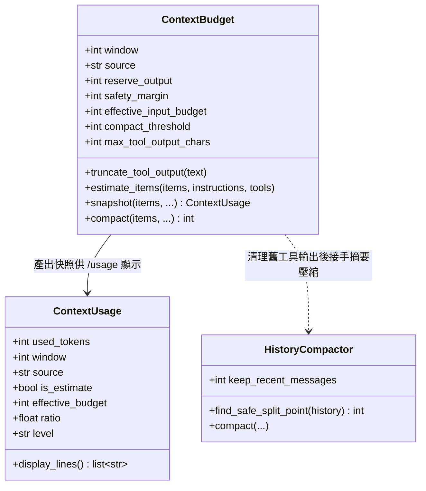
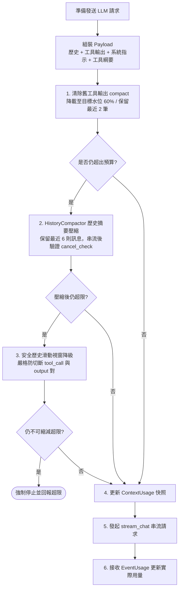

# Pocket Agent 上下文管理架構 (Context Budget & Compaction Architecture)

在處理大型程式庫或長對話任務時，語言模型容易遭遇上下文長度超載 (Context Overflow) 或因輸出被隨意裁減而引發重複重讀的惡性循環。為此，Pocket Agent 建立了與模型供應商解耦的**上下文預算機制 (`ContextBudget`)**、**巨量輸出落盤 (`Spillover`)** 與 **AI 歷史摘要壓縮 (`HistoryCompactor`)** 多層防護管線。

---

## 1. 核心設計架構與預算語意

上下文管理核心為 `pocket_agent.core.context_budget.ContextBudget`，數值常數集中維護於 `src/pocket_agent/system/constants.py`：

$$\text{可用輸入預算 (Effective Input Budget)} = \text{有效視窗} - \text{預留輸出空間} - \text{安全餘裕}$$



### 1.1 視窗來源優先級 (Window Resolution)

1. **使用者設定檔優先**：若在 `config.json` 或環境變數指定 `system.context_window`，則以其為最高優先級，**不觸發**外部網路端點查詢。
2. **供應商引擎查詢**：呼叫 `engine.context_window()` 取得模型上限。
3. **預設保底值 (Fallback)**：若皆未提供，採用 `DEFAULT_CONTEXT_WINDOW = 128,000` tokens（若目標模型實際視窗較小，可透過設定手動覆寫）。

### 1.2 預留空間與預設水位 (`constants.py`)

- **預留輸出空間 (`DEFAULT_RESERVE_OUTPUT_TOKENS`)**：預設保留 `4,096` tokens。
- **安全餘裕 (`DEFAULT_SAFETY_MARGIN_TOKENS`)**：預設保留 `1,024` tokens，吸收估算與 JSON 結構誤差（保守估算基準為 `CHARS_PER_TOKEN_ESTIMATE = 3`）。
- **觸發與目標水位**：工具輸出壓縮觸發門檻為有效預算之 `70%`（`DEFAULT_COMPACT_RATIO = 0.7`），目標降載水位為 `60%`（`DEFAULT_COMPACT_TARGET_RATIO = 0.6`），並保障最低輸入預算地板不小於 `1,000` tokens。

---

## 2. 送出前統一管理管線 (Pipeline Sequence)

在 Agent 主迴圈中，每一輪向 LLM 發出串流請求前，均依序執行統一的上下文縮減與防禦管線：



### 2.1 關鍵階段保護原則

1. **附加時截斷與巨量落盤 (Append-time Truncation & Spillover)**：
   單筆工具輸出超過有效視窗的 `8%`（`DEFAULT_TOOL_OUTPUT_RATIO = 0.08`）或落盤門檻時，會將完整輸出寫入工作區沙盒 `scratch/outputs/`，僅將頭尾預覽（預設各 `1,500` 字元）與檔案路徑注入 Context，避免單次工具結果撐爆預算。
2. **優先清除舊工具輸出 (`compact`)**：
   達門檻時由舊至新將 `function_call_output` 置換為語意佔位符（保留最近 `2` 筆原樣輸出與所有對話原文）。
3. **AI 歷史摘要壓縮 (`HistoryCompactor`)**：
   當清理工具輸出仍不足時，呼叫無工具的單次 LLM 摘要較舊歷史，保留最近 `6` 則訊息（`DEFAULT_COMPACTION_KEEP_MESSAGES = 6`）。串流結束後須再次驗證 `cancel_check`，**嚴禁於使用者取消後提交半截摘要**。
4. **成對邊界防護**：
   無論 `HistoryCompactor.find_safe_split_point` 或降級的滑動視窗，皆嚴密檢查邊界，確保不拆散成對的 `function_call` 與 `function_call_output`。

---

## 3. 檔案讀取雙重邊界防護

為防止單次 `read_file` 直接耗盡輸入預算，檔案工具層引入雙重上限：

- **行數上限 (`DEFAULT_READ_FILE_LINES`)**：未指定範圍時預設讀取最多 `500` 行。
- **字元數硬上限 (`DEFAULT_TOOL_OUTPUT_CHARS`)**：單次讀取嚴格限制為 `12,000` 字元；遇壓縮或單行超長檔案時即時截斷並回傳續讀游標（`char_offset` / `start_line`）提示。

---

## 4. 相關配置選項 (`config.json`)

使用者可在 `~/.pocket-agent/config.json` 的 `system` 區塊微調預算參數（完整欄位見 `docs/guides/configuration-specification.md`）：

```json
{
  "system": {
    "context_window": null,
    "context_reserve_output": 4096,
    "context_safety_margin": 1024,
    "context_compact_target_ratio": 0.6,
    "max_tool_rounds": 20
  }
}
```
