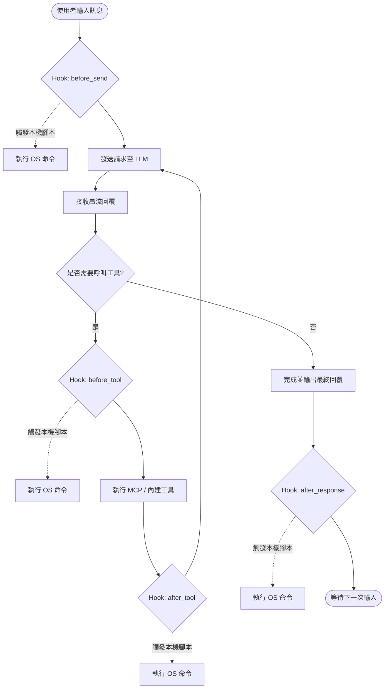

# Pocket Agent Hooks 生命週期機制

為了滿足高階使用者對於開發流程自動化的需求（例如：對話結束後自動 `git commit`、呼叫特定工具前通知外部系統），Pocket Agent 實作了基於事件驅動的 **Hooks 生命週期攔截機制**。

## 執行生命週期視覺化

Hooks 是在主對話迴圈（Main Loop）的特定節點觸發。所有 Hook 指令預設在背景透過 `subprocess` 獨立執行（Fire-and-forget 模式，帶有 30 秒逾時機制），**即使腳本發生錯誤，也不會打斷 AI 與使用者的對話。**



## 設定與環境變數注入

Hooks 設定檔位於 `~/.pocket-agent/hooks.json`。
Pocket Agent 會在觸發 Hook 時，將當下的上下文狀態（Context）透過**作業系統環境變數**注入到執行的 Process 中（以 `POCKETAGENT_` 為前綴），最大限制為 4000 字元。

### 支援的事件與對應變數

| 事件名稱         | 觸發時機                            | 注入的環境變數                                                              |
| :--------------- | :---------------------------------- | :-------------------------------------------------------------------------- |
| `before_send`    | 送出使用者訊息給 LLM 之前           | `POCKETAGENT_USER_INPUT` (使用者的文字)                                     |
| `after_response` | LLM 回覆完全結束（含所有工具鏈）後  | `POCKETAGENT_USER_INPUT`、`POCKETAGENT_REPLY` (完整回覆內容)                |
| `before_tool`    | 即將呼叫任何內建或 MCP 工具前       | `POCKETAGENT_TOOL_NAME` (工具名稱)、`POCKETAGENT_TOOL_ARGS` (JSON 參數字串) |
| `after_tool`     | 工具執行完成並準備回傳結果給 LLM 前 | `POCKETAGENT_TOOL_NAME`、`POCKETAGENT_TOOL_RESULT` (執行結果)               |

### 設定範例

```json
[
  {
    "name": "對話後自動 Commit",
    "event": "after_response",
    "command": "git add -A && git commit -m \"Auto commit after AI interaction\""
  }
]
```
