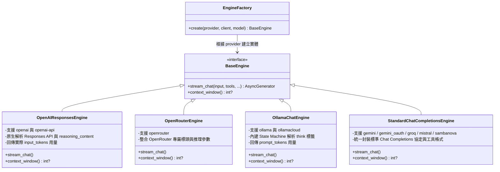
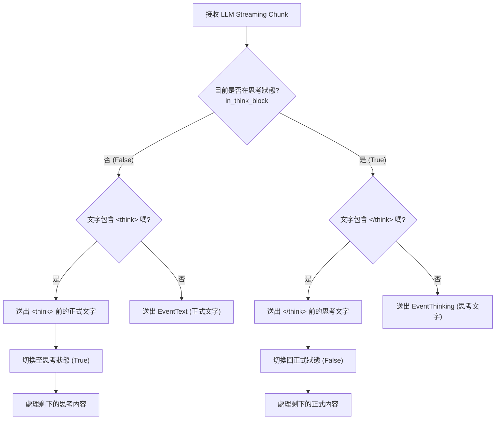

# Pocket Agent 多軌大模型轉接架構 (LLM Engine Adapter)

為了解決不同 LLM 提供者在 API 規格、認證方式與進階功能（例如 Reasoning 推理過程）上的差異，Pocket Agent 採用 **Adapter Pattern（轉接器模式）** 搭配 **EngineFactory**，將底層模型通訊抽象化為統一的 `BaseEngine` 介面與 `AsyncGenerator` 事件流（`EventText`、`EventThinking`、`EventToolCallStart`、`EventUsage` 等），確保上層 CLI 與 Agent 主迴圈能無縫切換供應商。

## 架構設計視覺化

`EngineFactory`（`src/pocket_agent/engines/factory.py`）依據顯式傳入的 `provider` 選擇對應引擎類別：

## `<think>` 標籤狀態機剖析機制 (State Machine)

OpenAI 等雲端模型原生支援獨立的推理區塊（Reasoning Content），但部分本地端開源模型（例如 DeepSeek-R1）會將思考過程以 `<think>...</think>` 標籤包裹，混在純文字回覆中一併串流回傳。

為此，`OllamaChatEngine` 內建了**串流狀態機 (Streaming State Machine)**，在收到每個文字區塊 (chunk) 時即時剝離思考內容與正式回覆，使 CLI 能獨立折疊或渲染思考過程，不污染主對話輸出：

## 關鍵優勢

1. **無縫切換**：使用者可透過 `/model` 指令即時切換雲端（OpenAI / OpenRouter / Gemini / Groq / Mistral / SambaNova / Ollama Cloud）或本機（Ollama）模型，上層渲染與工具呼叫邏輯完全不需修改。
2. **平滑相容**：無論底層是否原生支援分離式 Reasoning 欄位，轉接器皆統一收斂為 `EventThinking` 事件，提供一致的使用者體驗。
3. **職責分離與擴充性**：底層連線與憑證由 `Provider` 策略負責，協定與串流解析由 `Engine` 負責。新增相容 Chat Completions 的服務只需新增 `Provider` 並註冊於 `ENGINE_MAP`；若遇特殊協定，亦只需實作新的 `BaseEngine` 子類別即可。
