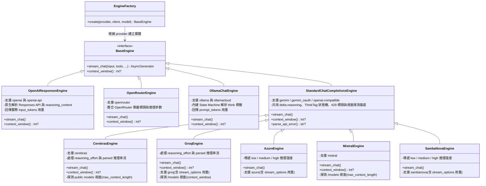
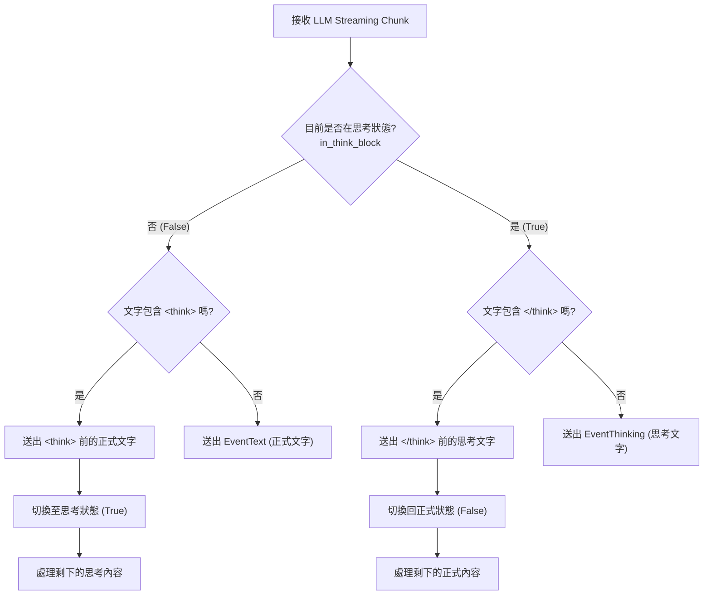

# Pocket Agent 多軌大模型轉接架構 (LLM Engine Adapter)

為了解決不同 LLM 提供者在 API 規格、認證方式與進階功能（例如 Reasoning 推理過程）上的差異，Pocket Agent 採用 **Adapter Pattern（轉接器模式）** 搭配 **EngineFactory**，將底層模型通訊抽象化為統一的 `BaseEngine` 介面與 `AsyncGenerator` 事件流（`EventText`、`EventThinking`、`EventToolCallStart`、`EventUsage` 等），確保上層 CLI 與 Agent 主迴圈能無縫切換供應商。

## 架構設計視覺化

`EngineFactory`（`src/pocket_agent/engines/factory.py`）依據顯式傳入的 `provider` 選擇對應引擎類別：

## `<think>` 標籤狀態機剖析機制 (State Machine)

OpenAI 等雲端模型原生支援獨立的推理區塊（Reasoning Content），但部分本地端開源模型（例如 DeepSeek-R1）會將思考過程以 `<think>...</think>` 標籤包裹，混在純文字回覆中一併串流回傳。

為此，`OllamaChatEngine` 內建了**串流狀態機 (Streaming State Machine)**，在收到每個文字區塊 (chunk) 時即時剝離思考內容與正式回覆，使 CLI 能獨立折疊或渲染思考過程，不污染主對話輸出：

## 關鍵優勢

1. **無縫切換**：使用者可透過 `/model` 指令即時切換雲端（OpenAI / OpenRouter / Cerebras / Gemini / Groq / Mistral / SambaNova / Azure / Ollama Cloud）或本機（Ollama / OpenAI-Compatible）模型，上層渲染與工具呼叫邏輯完全不需修改。
2. **平滑相容**：無論底層是否原生支援分離式 Reasoning 欄位，轉接器皆統一收斂為 `EventThinking` 事件，提供一致的使用者體驗。
3. **職責分離與擴充性**：底層連線與憑證由 `Provider` 策略負責，協定與串流解析由 `Engine` 負責。常見的 HTTP 429 限流標頭解析（`BaseEngine.parse_rate_limit_headers`）、被動回應標頭額度快照（`supports_header_quota`／`rate_limits.py`）與 `/models` 視窗探測（`StandardChatCompletionsEngine._fetch_context_window_from_models`）已集中於基底類別，各雲端供應商僅透過薄子類別宣告差異參數，新增標準相容服務只需實作 `Provider`（必要時加上薄 `Engine` 子類別）並註冊於 `ENGINE_MAP` 即可。

## 新增 LLM Provider 開發規範（檢查清單）

後續新增模型供應商時，必須依循以下低耦合分層與共用上提原則，不得在共用基底、CLI 或 Agent 主迴圈散落供應商條件分支：

1. **常數與設定隔離**：
   - 於 `system/constants.py` 新增 `PROVIDER_<NAME>` 常數；若使用環境變數金鑰，必須將其環境變數名稱加入 `SENSITIVE_ENV_EXACT_KEYS` 以防子行程洩漏。
   - 於 `system/config.py` 之 `DEFAULT_CONFIG["providers"]` 與 `EnvConfigProvider.ENV_MAP` 補齊預設設定與環境變數映射；金鑰鍵名須包含 `api_key` 或 `token`，以自動套用 OS Keyring／JWE 加密庫保護與 `/config` 遮罩。
2. **Provider 策略層（Strategy／Template Method）**：
   - 優先繼承 `system/providers/base.py` 的 `OpenAICompatibleProvider` 並覆寫宣告式屬性（`display_name`、`config_key`、`base_url`、`base_url_config_key`、`base_url_prompt_i18n_key`、`missing_key_i18n_key`、`fallback_models`、`fail_on_auth_error` 等），複用 `prompt_base_url`、`prompt_api_key`、`get_client` 與 `fetch_models`。
   - 於 `system/providers/__init__.py` 註冊至 `PROVIDER_STRATEGIES`；禁止在 `wizard.py` 或 `/model` 指令硬編碼供應商清單。
3. **Engine 轉接器分層與共用上提（Adapter／Factory）**：
   - **何時獨立建立 `<name>_engine.py`**：當供應商具備任一專屬協定行為（如 `supports_stream_usage` 差異、`reasoning_effort`／`reasoning_format` 轉換、`/models` 視窗探測、`get_quota` 或專屬錯誤解析）時，應建立繼承 `StandardChatCompletionsEngine` 的薄子類別（若協定完全非 Chat Completions 則繼承 `BaseEngine`）；僅當完全符合預設 Chat Completions 行為且無專屬參數時，方直接共用 `StandardChatCompletionsEngine`。
   - **共用能力優先複用基底**：串流推理欄位（`delta.reasoning_content` 與 `delta.reasoning`）、`<think>` 狀態機、`finish_reason == "tool_calls"` 工具派發邊界、HTTP 429 標頭解析（`BaseEngine.parse_rate_limit_headers()`）與 `/models` 視窗探測（`StandardChatCompletionsEngine._fetch_context_window_from_models()`）一律集中於基底維護；若供應商透過 `x-ratelimit-*` 回應標頭回報即時限流額度，僅需在薄引擎子類別宣告 `supports_header_quota = True`，即自動複用 `engines/rate_limits.py` 與 `StandardChatCompletionsEngine` 的標頭快照及 `/usage` 呈現。禁止在基底寫 `if provider == ...` 分支，也禁止在各子類別複製貼上 HTTP 請求、快取、429 或標頭額度解析樣板。
   - **推理強度安全預設**：`format_reasoning_param()` 遇到 `"auto"` 或未設定時不得送出供應商推理參數，以免非推理模型回傳 HTTP 400。
   - **工廠與能力旗標**：於 `engines/factory.py` 的 `ENGINE_MAP` 註冊引擎，並於 `resolve_provider()` 使用 `_matches_host()` 嚴格網域比對（禁止子字串比對）；前端功能判斷僅能查詢引擎／Agent 能力旗標（如 `supports_image_generation`）。
4. **多語系（i18n）同步**：
   - 缺金鑰提示、精靈提示與錯誤訊息一律於執行期透過 `t(key, **kwargs)` 解析，並同步更新 `src/pocket_agent/locales/*.json` 所有語系檔且維持佔位符一致。
5. **離線測試與文件同步**：
   - 新增 `tests/test_<name>_provider.py`（完全離線、隔離網路與憑證、測試後清理 `_context_window_cache`），同步更新 `tests/test_system_constants.py`，並更新 `docs/PROJECT_INSTRUCTIONS.md`、`docs/architecture/llm-adapter-architecture.md`、`docs/guides/configuration-specification.md`、`README.md` 與 `README.zh-TW.md`；修改完成後將 Ruff、依賴掃描與 pytest 驗證指令交付使用者手動執行。
