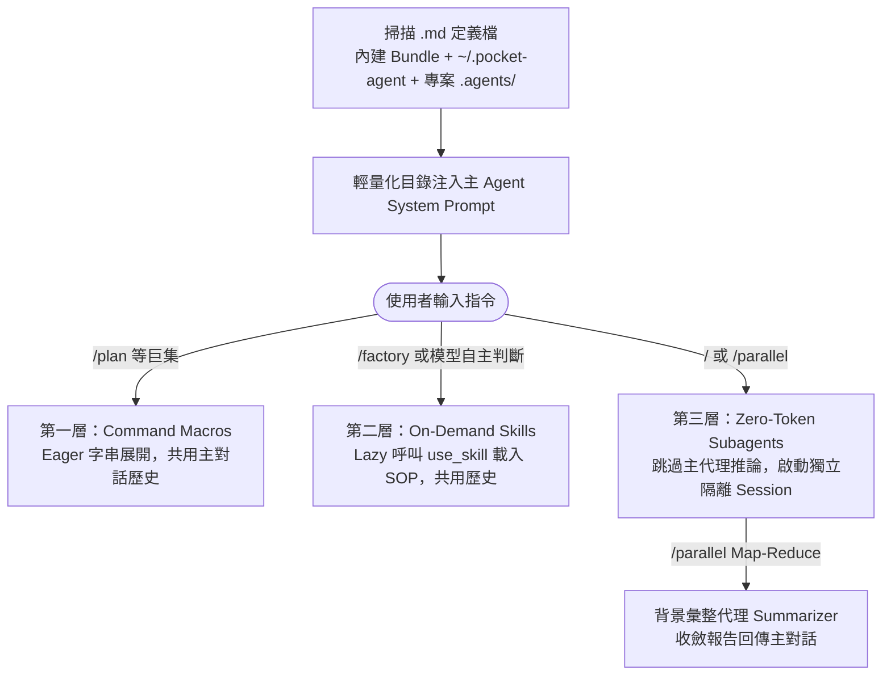

# Pocket Agent 三層式路由、分層配置與子代理機制

面對大型重構、全域除錯與跨檔案檢索等複雜任務時，單一長對話極易引發「上下文超載 (Context Overflow)」與「Token 消耗過高」。Pocket Agent 透過**分層配置語意**與**三層式混合路由架構**，在上下文連貫性、能力擴充與隔離防護之間取得平衡。

---

## 1. Configuration Model 的四種核心語意

為了維持跨專案擴充性與環境隔離，系統明確區分四種生命週期物件：

| 層級 | 處理語意 | 來源與規則 |
| :--- | :--- | :--- |
| **Secrets（機密憑證）** | **Strict Isolation（嚴格隔離）** | API Key、OAuth Token 絕不與一般設定混用，由 OS Keyring（或 JWE 加密庫）獨立管理。 |
| **Runtime Config（機制配置）** | **Deterministic Merge（決定性合併）** | CLI 即時指令 → 環境變數 / `.env` → `~/.pocket-agent/config.json` → 系統預設值，由程式碼決定性覆寫。 |
| **Instructions（自然語言上下文）** | **Concatenate Chain（依序疊加）** | 載入全域 `~/.pocket-agent/instructions.md` 後，於尾端附加專案入口 `AGENTS.md`（或 `.agents/AGENTS.md`）並展開連結文件（總上限 `24,000` 字元）。 |
| **Skills（技能擴充）** | **Shadowing + Progressive Disclosure** | 專案 `.agents/skills/` 同名技能無條件遮蔽全域 `~/.pocket-agent/skills/`；啟動時僅注入名稱與描述目錄，需要時才載入 `SKILL.md` 全文。 |

---

## 2. 三層式混合路由架構 (Three-Tiered Routing)

CLI 收到指令後，會依深度路由至以下三個層級：

### 2.1 三層架構綜合比較

| 比較維度 | 第一層：指令巨集（Command） | 第二層：動態技能（Skill） | 第三層：子代理（Subagent） |
| :--- | :--- | :--- | :--- |
| **代表範例** | `/plan 實作登入功能` | `/factory 分析專案` 或 `use_skill` | `/researcher 查漏洞`、`/parallel a:任務1 \| b:任務2` |
| **上下文狀態** | 與主代理共用歷史紀錄 | 與主代理共用歷史紀錄 | **絕對隔離**，僅接收任務描述（Fresh Context） |
| **載入與消耗** | **預先載入 (Eager)**：送出前展開模板，消耗固定 Token | **惰性載入 (Lazy)**：僅在呼叫 `use_skill` 時讀入全文 | **Zero-Token 派發**：CLI 底層攔截直通，免主代理推論 |
| **AI 自主性** | 僅限人類手動輸入觸發 | 可透過 SQLite FTS5 / BM25 目錄自主發現與調閱 | CLI 捷徑由人類直通；主代理亦可自主呼叫 `run_subagent` |
| **優缺點與適用** | 快速防呆、格式一致；複雜模板易拉長 Prompt | 能承接歷史決策執行嚴謹 SOP；思考過程留在主視窗 | 極速隔離大量搜尋雜訊；缺乏主會話歷史，指派須明確 |

---

## 3. 子代理執行期隔離與可視性

- **獨立 Session 與乾淨上下文**：無論透過 `/<name>` 捷徑或 `run_subagent` 觸發，系統皆啟動全新 `Agent(is_subagent=True)` 實例，子代理看不到主對話歷史，強制明確定義任務範圍與驗收標準。
- **進度串流轉發 (Stream Forwarding)**：子代理的思考過程與工具呼叫會加上專屬前綴（如 `[researcher]`）即時串流至終端機，兼顧隔離與可觀測性。
- **安全防失控邊界**：子代理執行時不會觸發全域 Hooks，亦禁止無限遞迴再開子代理；任務結束後僅回傳摘要成果，維持主會話上下文乾淨。
- **權限確認同步**：CLI 端透過 `ConfirmationBridge` 統一橋接確認流程，啟用 `Accept-edits` 時會同步套用至主代理與所有 `active_subagents`。

---

## 4. 平行節流與背景唯讀子代理多工

PocketAgent 現已原生支援**非阻塞背景子代理作業**，能在單一 `asyncio` 事件迴圈中非同步執行多項唯讀研究任務，完全不阻塞前景對話。搭配終端機雙行即時狀態列、非侵入式完成通知與回覆頁尾計數徽章，使用者可清楚掌握背景任務進度並在適當時機取回成果。

### 4.1 四種子代理執行模式詳解

1. **模式 1：前景單一子代理（Foreground Single）**
   - **觸發方式**：主代理 LLM 呼叫 `run_subagent`，或使用者於 CLI 輸入 `/<name> <task>`、`/subagent <name> <task>`。
   - **執行與注入行為**：阻塞當前對話輪次直到子代理完成；執行期間會將思考與工具呼叫即時串流至終端機。任務完成後，成果會**自動注入**主代理上下文（或由主代理直接承接後續動作），例如針對 `subagents/researcher.md` 觸發 `post_actions.require_save_prompt` 詢問使用者是否存檔。

2. **模式 2：前景平行子代理（Foreground Parallel）**
   - **觸發方式**：主代理 LLM 呼叫 `run_subagents_parallel`、同輪發起多筆唯讀 `run_subagent`，或使用者於 CLI 輸入 `/parallel <name:task> | <name:task>`。
   - **執行與注入行為**：阻塞當前輪次，以 `DEFAULT_MAX_PARALLEL_SUBAGENTS`（預設 `3`）進行並發節流，並為同名子代理自動標記 `#1`、`#2` 標籤以正確更新 `MultiStatus` 狀態列；平行批次期間停用互動式 `ask_question` 以避免搶佔終端機輸入。完成後，結果會**自動注入／彙整**回主代理（`/parallel` 會透過輕量 Summarizer 代理收斂成單一報告）。

3. **模式 3：背景子代理 — 主代理 LLM 自主控制（Background LLM-Controlled）**
   - **觸發方式**：主代理 LLM 自主呼叫 `start_background_subagent`，後續透過 `check_background_subagent` 查詢／取回或以 `cancel_background_subagent` 取消。
   - **執行與注入行為**：**非阻塞**，派發後主代理立即回覆並把輸入框交還使用者，使用者可持續進行其他前景對話。此模式採用**顯式拉取（Explicit Pull）**：唯有當主代理呼叫 `check_background_subagent(job_id)` 且該工作已完成時，系統才會將以 `<external_content>` 包覆的報告正式注入主代理上下文，同步合併 `activity` 變更紀錄、傳染 `is_sensitive_session` 敏感旗標，並附帶 `post_actions.require_save_prompt`（例如要求主代理詢問是否存檔），由主代理接手後續作業。

4. **模式 4：背景子代理 — 使用者 CLI 手動控制（Background CLI-Controlled）**
   - **觸發方式**：使用者直接輸入 `/bg <name> <task>` 派發，並透過 `/jobs`（預設僅顯示活躍工作，`all` 查看完整歷史，`show <id>`、`collect [id]`、`cancel <id|all>`、`clear` 清除已結束紀錄）管理。
   - **執行與注入行為**：**非阻塞**，且派發階段完全不經主代理推論（**零派發 Token 消耗**）。任務完成後提供兩種檢視路徑：
     - `/jobs show <id>`：僅在終端機**預覽**報告內容，**不會**寫入主對話歷史，也不消耗主代理 Token。
     - `/jobs collect [id]`：將指定（或全部）已完成報告**顯式注入**主代理的對話歷史（`history`），讓主代理在下一輪對話即可直接依據該報告接續撰寫、分析或詢問存檔。
     - 記憶體中最多保留 `DEFAULT_MAX_BACKGROUND_JOB_HISTORY`（預設 `20` 筆）已結束紀錄，使用者可隨時透過 `/jobs clear` 或 `/new` 清除已結束紀錄（保留執行中工作）。

### 4.2 四種模式差異比較表

| 比較維度 | 模式 1：前景單一子代理 | 模式 2：前景平行子代理 | 模式 3：背景 LLM 自主控制 | 模式 4：背景 CLI 手動控制 |
| :--- | :--- | :--- | :--- | :--- |
| **觸發方式** | `run_subagent` / `/<name>` / `/subagent` | `run_subagents_parallel` / 同輪多筆唯讀 / `/parallel` | `start_background_subagent` + `check_background_subagent` | `/bg <name> <task>` + `/jobs [show\|collect\|cancel]` |
| **是否阻塞前景** | **阻塞**（等待該子代理完成） | **阻塞**（等待整批完成或彙整） | **非阻塞**（立即交還輸入提示符） | **非阻塞**（立即交還輸入提示符） |
| **工具權限與確認** | 依子代理定義，支援確認橋接 | `/parallel` 與同輪批次停用 `ask_question` | **嚴格唯讀免確認**（`on_confirm=None`、`accept_edits=False`） | **嚴格唯讀免確認**（`on_confirm=None`、`accept_edits=False`） |
| **並發與可視化** | 單一子代理即時串流 | 上限 `3` 並發，`MultiStatus` 逐列進度（`#1`、`#2`） | 上限 `3` 並發，雙行狀態列 + 完成提示 + 頁尾徽章 | 上限 `3` 並發，雙行狀態列 + 完成提示 + 頁尾徽章 |
| **成果進入主代理時機** | 完成後**自動注入** | 完成後**自動注入／彙整** | 呼叫 `check_background_subagent` 時**顯式拉取注入** | `/jobs show` 僅預覽；`/jobs collect` **顯式注入** `history` |
| **主代理後續接手** | 立即接手（含 `require_save_prompt`） | 立即接手或由 Summarizer 收斂 | 取回時傳遞 `require_save_prompt`、`activity` 與敏感旗標 | `/jobs collect` 注入後於下一輪提問接手 |

### 4.3 為何背景模式採顯式拉取（Explicit Pull）而非自動插話

背景任務若在完成瞬間強制插話並自動觸發主代理推論，容易在使用者打字或前景串流回覆中途打斷終端機畫面，並產生預期外的 Token 消耗。因此，PocketAgent 將背景模式設計為**「狀態即時可見，成果顯式取回」**：使用者可隨時從狀態列與完成通知得知進度，並自主決定要以 `/jobs show <id>` 單純閱讀、以 `/jobs collect [id]` 注入主對話，或是請主代理呼叫 `check_background_subagent` 接手後續處理。

### 4.4 背景可視化與安全不變量

- **終端機可視化機制**：
  - **即時雙行底部狀態列**：有背景工作執行或待取回時，底部狀態列自動展開第二行，顯示動態 Spinner、`job_id`、子代理名稱、當前工具／進度與經過秒數；當存在已完成待取回報告時轉為綠色提示 `/jobs collect`，全部取回或取消後自動摺疊回單行。
  - **非侵入式完成通知**：背景工作完成或失敗時透過 `run_in_terminal()` 輸出簡潔提示（若前景正在串流回覆則暫存佇列，待前景閒置時補印，不破壞輸出排版）。
  - **回覆頁尾徽章**：主代理每輪回覆頁尾摘要同步附帶背景執行中／待取回數量徽章。
- **背景安全不變量**：
  - **嚴格唯讀白名單**：強制過濾並僅保留唯讀免確認工具（排除檔案寫入、Shell、`ask_question` 及 `browser`、`win_rdp` 等有狀態 MCP 工具），純寫入型子代理無法於背景啟動。
  - **並發與取消隔離**：並發上限為 `DEFAULT_MAX_BACKGROUND_SUBAGENTS`（預設 `3`）；每個背景工作皆運行於獨立 `CancellationScope` 中，前景按下 `Ctrl+C` 不會誤殺背景工作，僅能透過 `/jobs cancel`、`cancel_background_subagent` 或結束程式時的 `Agent.shutdown()` 取消並收斂。
