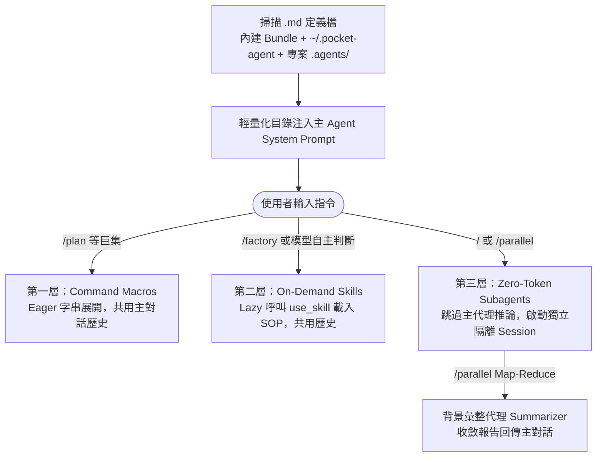

# Pocket Agent 三層式路由、分層配置與子代理機制

面對大型重構、全域除錯與跨檔案檢索等複雜任務時，單一長對話極易引發「上下文超載 (Context Overflow)」與「Token 消耗過高」。Pocket Agent 透過**分層配置語意**與**三層式混合路由架構**，在上下文連貫性、能力擴充與隔離防護之間取得平衡。

---

## 1. Configuration Model 的四種核心語意

為了維持跨專案擴充性與環境隔離，系統明確區分四種生命週期物件：

| 層級 | 處理語意 | 來源與規則 |
| :--- | :--- | :--- |
| **Secrets（機密憑證）** | **Strict Isolation（嚴格隔離）** | API Key、OAuth Token 絕不與一般設定混用，由 OS Keyring（或 JWE 加密庫）獨立管理。 |
| **Runtime Config（機制配置）** | **Deterministic Merge（決定性合併）** | CLI 即時指令 → 環境變數 / `.env` → `~/.pocket-agent/config.json` → 系統預設值，由程式碼決定性覆寫。 |
| **Instructions（自然語言上下文）** | **Concatenate Chain（依序疊加）** | 載入全域 `~/.pocket-agent/instructions.md` 後，於尾端附加專案入口 `AGENTS.md`（或 `.agents/AGENTS.md`）並展開連結文件（總上限 `24,000` 字元）。 |
| **Skills（技能擴充）** | **Shadowing + Progressive Disclosure** | 專案 `.agents/skills/` 同名技能無條件遮蔽全域 `~/.pocket-agent/skills/`；啟動時僅注入名稱與描述目錄，需要時才載入 `SKILL.md` 全文。 |

---

## 2. 三層式混合路由架構 (Three-Tiered Routing)

CLI 收到指令後，會依深度路由至以下三個層級：

### 2.1 三層架構綜合比較

| 比較維度 | 第一層：指令巨集（Command） | 第二層：動態技能（Skill） | 第三層：子代理（Subagent） |
| :--- | :--- | :--- | :--- |
| **代表範例** | `/plan 實作登入功能` | `/factory 分析專案` 或 `use_skill` | `/researcher 查漏洞`、`/parallel a:任務1 \| b:任務2` |
| **上下文狀態** | 與主代理共用歷史紀錄 | 與主代理共用歷史紀錄 | **絕對隔離**，僅接收任務描述（Fresh Context） |
| **載入與消耗** | **預先載入 (Eager)**：送出前展開模板，消耗固定 Token | **惰性載入 (Lazy)**：僅在呼叫 `use_skill` 時讀入全文 | **Zero-Token 派發**：CLI 底層攔截直通，免主代理推論 |
| **AI 自主性** | 僅限人類手動輸入觸發 | 可透過 SQLite FTS5 / BM25 目錄自主發現與調閱 | CLI 捷徑由人類直通；主代理亦可自主呼叫 `run_subagent` |
| **優缺點與適用** | 快速防呆、格式一致；複雜模板易拉長 Prompt | 能承接歷史決策執行嚴謹 SOP；思考過程留在主視窗 | 極速隔離大量搜尋雜訊；缺乏主會話歷史，指派須明確 |

---

## 3. 子代理執行期隔離與可視性

- **獨立 Session 與乾淨上下文**：無論透過 `/<name>` 捷徑或 `run_subagent` 觸發，系統皆啟動全新 `Agent(is_subagent=True)` 實例，子代理看不到主對話歷史，強制明確定義任務範圍與驗收標準。
- **進度串流轉發 (Stream Forwarding)**：子代理的思考過程與工具呼叫會加上專屬前綴（如 `[researcher]`）即時串流至終端機，兼顧隔離與可觀測性。
- **安全防失控邊界**：子代理執行時不會觸發全域 Hooks，亦禁止無限遞迴再開子代理；任務結束後僅回傳摘要成果，維持主會話上下文乾淨。
- **權限確認同步**：CLI 端透過 `ConfirmationBridge` 統一橋接確認流程，啟用 `Accept-edits` 時會同步套用至主代理與所有 `active_subagents`。
