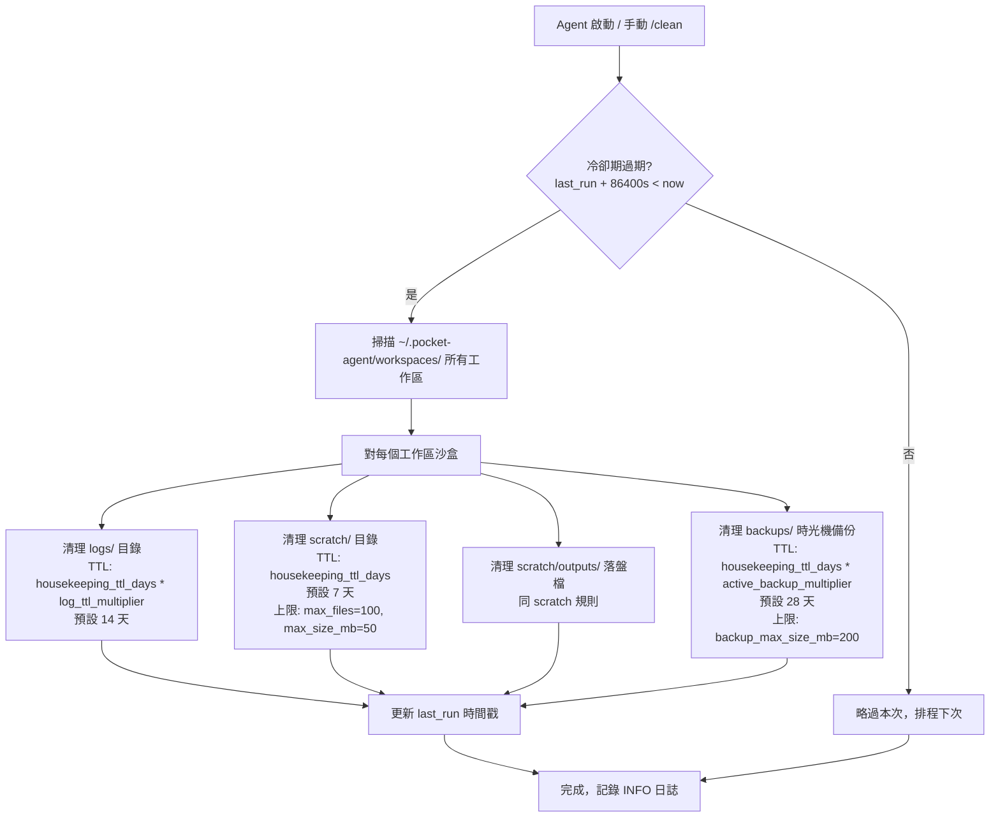
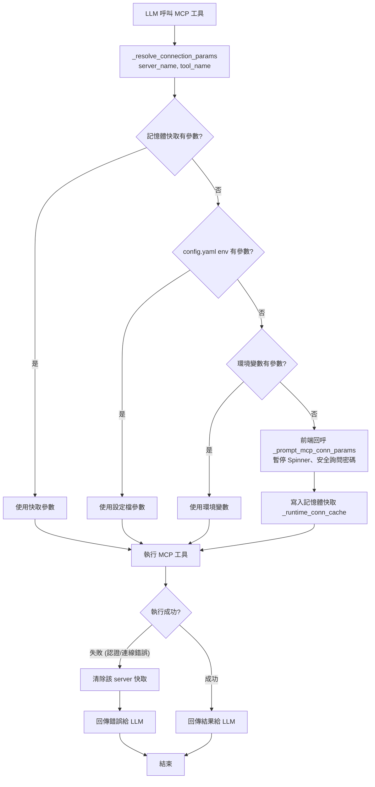

# PocketAgent 排程作業文件

> **語系說明**：本文件語系遵循使用者提問語系（預設繁體中文）。若使用者以英文提問，請切換為英文輸出。

---

## 1. 排程作業總覽

| 作業名稱       | 排程類型       | 執行頻率       | 觸發條件          | 負責模組                  | 失敗處理                    |
| -------------- | -------------- | -------------- | ----------------- | ------------------------- | --------------------------- |
| Housekeeping 自動管家 | 內建非同步排程器 | 每 24 小時 (可配置) | 應用啟動後、冷卻期過後 | `pocket_agent.system.housekeeping` | 記錄錯誤日誌、不中斷主流程、下次冷卻期重試 |
| Session Prune 手動清理 | CLI 互動指令 (`/prune`) | 使用者手動觸發 | 使用者輸入 `/prune` | `pocket_agent.core.sessions` | 互動式確認、失敗顯示錯誤訊息 |
| MCP 連線健康檢查 | 被動式 (工具呼叫時) | 每次 MCP 工具呼叫前 | 工具被 LLM 呼叫時 | `pocket_agent.extensions.mcp.MCPManager` | 連線失敗清除快取、提示重新輸入憑證 |

---

## 2. 作業詳細規格

### 2.1 Housekeeping 自動管家

| 項目                   | 說明                                                                                                     |
| ---------------------- | -------------------------------------------------------------------------------------------------------- |
| **作業 ID**            | `housekeeping`                                                                                           |
| **排程類型**           | 內建非同步排程器 (asyncio background task)                                                                |
| **Cron 表達式 / 間隔** | 固定間隔：`DEFAULT_HOUSEKEEPING_COOLDOWN_SECONDS = 86400` (24 小時)，啟動後立即檢查冷卻期是否過期          |
| **時區**               | 系統本地時間 (UTC offset 依作業系統)                                                                     |
| **執行逾時**           | 無硬性逾時；單一目錄掃描受 `MAX_FILE_SEARCH_SIZE_BYTES` (5 MB) 與檔案數上限保護                          |
| **重試策略**           | 失敗記錄警告日誌，不重試；下次冷卻期自然觸發                                                             |
| **並發控制**           | 單一背景任務，`housekeeping_task` 唯一引用，防止重複執行                                                 |
| **負責模組/服務**      | `pocket_agent.system.housekeeping.Housekeeper`                                                           |
| **入口點**             | `Housekeeper.start()` → `Agent.__init__` 啟動時自動排程；`/clean` CLI 指令可手動觸發 `Housekeeper.run_once()` |

#### 業務邏輯流程



#### 失敗處理與告警

| 失敗情境         | 偵測方式           | 自動恢復         | 人工介入           | 告警管道          |
| ---------------- | ------------------ | ---------------- | ------------------ | ----------------- |
| 工作區目錄權限錯誤 | `OSError` (PermissionError) | 無 (下次冷卻期重試) | 檢查目錄權限、以管理員執行 | `agent.log` WARNING 等級 |
| 檔案被佔用無法刪除 | `OSError` (PermissionError/AccessDenied) | 略過該檔案，繼續下一個 | 關閉佔用進程、手動清理 | `agent.log` WARNING 等級 |
| 磁碟空間不足 | `OSError` (ENOSPC) | 無 | 清理磁碟空間 | `agent.log` ERROR 等級 |
| 背景任務例外中斷 | `asyncio.CancelledError` / 任意例外 | 任務結束，下次冷卻期重建 | 檢查 `agent.log` 堆疊追蹤 | `agent.log` ERROR 等級 |

#### 相依資源

- **檔案系統**：`~/.pocket-agent/workspaces/<slug>/logs/`、`scratch/`、`scratch/outputs/`、`backups/`
- **設定檔**：`config.json` 的 `system.housekeeping_*` 參數
- **路徑解析**：`pocket_agent.system.paths.user_dir()`、`workspace_dir()`

> **架構師風險評估**：
>
> - [x] 執行時間是否會與其他作業衝突：單一背景任務，冷卻期機制防止頻繁執行，不佔用主執行緒
> - [x] 冪等性是否保證：掃描時機為「目前時間 - TTL」，多次執行結果一致；檔案刪除具冪等性
> - [x] 資料一致性邊界是否明確：僅清理沙盒目錄，不觸碰專案原始碼、使用者資料、會話 JSON (含 HMAC)
> - [x] 長時間執行是否有進度回報：大量檔案時無進度回報，但受 `max_files`/`max_size_mb` 上限保護，單次掃描通常 < 1 秒
> - [!] 潛在風險：Windows 上檔案被防毒軟體掃描佔用可能導致刪除失敗；大量工作區時依序掃描可能累積耗時

---

### 2.2 Session Prune 手動清理 (`/prune`)

| 項目                   | 說明                                                                                                     |
| ---------------------- | -------------------------------------------------------------------------------------------------------- |
| **作業 ID**            | `session_prune`                                                                                          |
| **排程類型**           | CLI 互動指令 (使用者手動觸發)                                                                            |
| **觸發條件**           | 使用者輸入 `/prune [<days> \| --keep <count>]`                                                           |
| **執行逾時**           | 受 `DEFAULT_CLI_TIMEOUT_SEC = 60` 秒限制                                                                 |
| **重試策略**           | 無自動重試；使用者可重新輸入指令                                                                         |
| **並發控制**           | CLI 互動模式下單一執行緒，無並發問題                                                                     |
| **負責模組/服務**      | `pocket_agent.core.sessions.prune_sessions()`                                                            |
| **入口點**             | `CliCommandRegistry` 註冊 `SessionPruneCommand` → `CommandHandler.dispatch()`                            |

#### 業務邏輯流程

```mermaid
flowchart TD
    Start[使用者輸入 /prune] --> ParseArgs[解析參數: days=30, keep=20]
    ParseArgs --> Confirm{確認刪除?<br/>[y: once / a: session / A: allowlist / N: deny]}
    Confirm -- 否 --> Cancel[取消操作]
    Confirm -- 是 --> ScanSessions[掃描 ~/.pocket-agent/sessions/*.json]
    ScanSessions --> FilterExpired[篩選: mtime > days 天前<br/>保護: 目前活躍 session、最新 keep 筆]
    FilterExpired --> DeleteFiles[刪除符合條件的 session 檔案]
    DeleteFiles --> Report[回報刪除筆數、釋放空間]
    Cancel --> Done[結束]
    Report --> Done
```

#### 失敗處理與告警

| 失敗情境         | 偵測方式           | 自動恢復         | 人工介入           | 告警管道          |
| ---------------- | ------------------ | ---------------- | ------------------ | ----------------- |
| Session 檔案損毀/無法讀取 | `json.JSONDecodeError` / `OSError` | 略過該檔案 | 手動檢查/刪除損毀檔案 | CLI 紅色錯誤訊息 |
| HMAC 簽章驗證失敗 | 簽章不符 | 略過該檔案 (視為損毀) | 檢查是否被竄改 | CLI 紅色錯誤訊息 + `agent.log` WARNING |
| 刪除權限不足 | `PermissionError` | 無 | 以管理員權限執行 | CLI 紅色錯誤訊息 |

#### 相依資源

- **檔案系統**：`~/.pocket-agent/sessions/*.json` (含 HMAC-SHA256 簽章)
- **設定檔**：無專用設定，使用預設值 `DEFAULT_SESSION_PRUNE_DAYS=30`、`DEFAULT_SESSION_PRUNE_KEEP=20`

> **架構師風險評估**：
>
> - [x] 執行時間是否會與其他作業衝突：使用者手動觸發，無排程衝突
> - [x] 冪等性是否保證：依檔案修改時間與保留筆數判斷，重複執行不會重複刪除
> - [x] 資料一致性邊界是否明確：保護目前活躍 session、保留最新 N 筆，HMAC 驗證防竄改
> - [x] 長時間執行是否有進度回報：session 檔案通常 < 100 筆，執行極快，無需進度回報

---

### 2.3 MCP 連線健康檢查 (被動式)

| 項目                   | 說明                                                                                                     |
| ---------------------- | -------------------------------------------------------------------------------------------------------- |
| **作業 ID**            | `mcp_connection_health`                                                                                  |
| **排程類型**           | 被動式 (工具呼叫前檢查)                                                                                  |
| **觸發條件**           | LLM 呼叫 MCP 工具時，`MCPManager.call_tool()` 執行前                                                     |
| **執行逾時**           | 受工具本身逾時限制 (SSH: ~30s, RDP: ~60s, 資料庫: ~15s)                                                  |
| **重試策略**           | 連線失敗/認證失敗 → 清除記憶體快取 → 下次呼叫重新提示輸入憑證                                          |
| **並發控制**           | 每工具呼叫獨立檢查，`_runtime_conn_cache` 以 server_name 隔離                                           |
| **負責模組/服務**      | `pocket_agent.extensions.mcp.MCPManager`、`pocket_agent.frontend.cli.main._prompt_mcp_conn_params()`     |
| **入口點**             | `MCPManager.call_tool()` → `_resolve_connection_params()` → 缺漏參數觸發前端回呼 `_prompt_mcp_conn_params()` |

#### 業務邏輯流程



#### 失敗處理與告警

| 失敗情境         | 偵測方式           | 自動恢復         | 人工介入           | 告警管道          |
| ---------------- | ------------------ | ---------------- | ------------------ | ----------------- |
| SSH 連線逾時/拒絕 | `ssh` 非零退出碼、stderr 關鍵字 | 清除快取，下次重新提示 | 檢查主機/埠/防火牆/金鑰 | 工具結果 `[ERROR]` + `agent.log` WARNING |
| SSH 認證失敗 | `Permission denied`、密碼/金鑰錯誤 | 清除快取，下次重新提示 | 確認帳密/金鑰/Passphrase | 工具結果 `[ERROR]` + `agent.log` WARNING |
| RDP 連線失敗 | `mstsc.exe` 異常退出、視窗類別不符 | 清除快取，下次重新提示 | 檢查主機/埠/帳密/網路 | 工具結果 `[ERROR]` + `agent.log` WARNING |
| 資料庫連線失敗 | `pymysql`/`pymssql` 例外 | 清除快取，下次重新提示 | 檢查主機/埠/帳密/資料庫名 | 工具結果 `[ERROR]` + `agent.log` WARNING |
| 使用者取消輸入 | `KeyboardInterrupt`/`EOFError` | 回傳已收集參數 (可能不完整) | 重新呼叫工具 | CLI 黃色提示 `操作已取消` |

#### 相依資源

- **網路**：SSH (Port 22)、RDP (Port 3389)、MySQL (Port 3306)、SQL Server (Port 1433)
- **設定檔**：`mcp_config.yaml` 的 `servers.<name>.env`、`inject`、`safe_read_tools`
- **OS Keyring**：MCP OAuth 2.1 Token 儲存 (`mcp-oauth-<server>`, `mcp-client-<server>`)
- **記憶體快取**：`MCPManager._runtime_conn_cache` (執行期唯一，不落盤)

> **架構師風險評估**：
>
> - [x] 執行時間是否會與其他作業衝突：被動觸發，無排程衝突；記憶體快取避免重複提示
> - [x] 冪等性是否保證：連線參數解析為純函式，快取寫入具冪等性；失敗清除快收保證下次重新驗證
> - [x] 資料一致性邊界是否明確：密碼僅存記憶體、Keyring 加密儲存、不寫入日誌 (遮罩 `[REDACTED]`)
> - [x] 長時間執行是否有進度回報：SSH/RDP 連線建立有逾時保護；CLI Spinner 顯示「連線中...」
> - [!] 潛在風險：`_prompt_mcp_conn_params` 需暫停 `rich.status` Spinner 避免渲染衝突；Windows `CONIN$` 直接讀取可能與 prompt-toolkit 衝突

---

## 3. 排程器基礎設施

| 元件           | 實作                                                                  | 版本        | 設定位置                              | 高可用性                                                                 |
| -------------- | --------------------------------------------------------------------- | ----------- | ------------------------------------- | ------------------------------------------------------------------------ |
| **內建排程器** | `asyncio.create_task()` + 冷卻期時間戳 (`housekeeping.py`)            | Python 3.14 | `config.json` `system.housekeeping_*` | 單進程單任務；Agent 重啟自動恢復排程；無分散式協調需求                   |
| **OS 層排程**  | 無 (不使用 Cron/Windows Task Scheduler)                               | -           | -                                     | -                                                                        |
| **CLI 指令**   | `Click` 註冊 slash command (`/clean`, `/prune`)                       | Click 8.5.0 | `src/pocket_agent/frontend/cli/commands/` | 使用者手動觸發，天然高可用                                               |

---

## 4. 監控與可觀測性

| 指標           | 來源                       | 告警閾值                         | 儀表板                        |
| -------------- | -------------------------- | -------------------------------- | ----------------------------- |
| **Housekeeping 執行成功率** | `agent.log` (INFO/WARNING/ERROR) | 連續 3 次失敗 → 人工介入          | `grep "Housekeeping" ~/.pocket-agent/workspaces/*/logs/agent.log` |
| **Housekeeping 執行耗時**   | `agent.log` 時間戳差值     | > 30 秒 → 檢查檔案數/磁碟 IO     | 同上                          |
| **Session 檔案總數/大小**   | `ls -la ~/.pocket-agent/sessions/` | > 1000 檔或 > 100 MB → 建議 `/prune` | `du -sh ~/.pocket-agent/sessions/` |
| **MCP 連線失敗率**          | `agent.log` `[ERROR]` 含 `mcp` | 同一 server 連續 3 次失敗 → 檢查設定 | `grep "mcp.*ERROR" ~/.pocket-agent/workspaces/*/logs/agent.log` |
| **沙盒目錄佔用**            | `Housekeeper` 掃描統計     | > `max_size_mb` (預設 50 MB) → 自動清理至 80% | `Housekeeper` 日誌輸出        |

---

## 5. 變更記錄

| 版本        | 日期     | 作者       | 變更摘要 |
| ----------- | -------- | ---------- | -------- |
| 0.1.0       | 2025-01-15 | PocketAgent Team | 初版建立 (由 generate-system-docs 自動產生) |