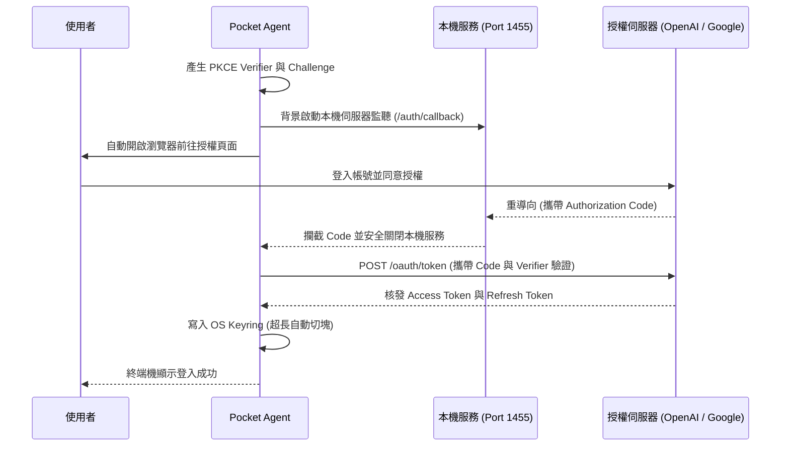

# Pocket Agent 認證與敏感憑證保護機制

本文件說明 Pocket Agent 的 **OAuth 2.0 PKCE** 登入流程（實作於 `src/pocket_agent/system/auth.py`）與 **OS Keyring 敏感憑證保護**架構，確保 API Key 與 OAuth Token 不在程式碼或本機檔案中以明碼暴露。

---

## 1. OAuth 2.0 PKCE 認證流程 (OpenAI / Google Gemini)

系統採用 **OAuth 2.0 PKCE (Proof Key for Code Exchange)** 處理 ChatGPT 與 Google Gemini 登入，無需在程式碼寫死 Client Secret：

### 關鍵實作細節

1. **PKCE 防護**：每次登入動態產生 `code_verifier` 與雜湊後的 `code_challenge`，交換 Token 時再次核對，防止授權碼遭本機惡意程式攔截。
2. **本機回呼路由**：利用 `FastAPI` 與 `uvicorn` 在背景執行緒建立臨時伺服器（預設監聽 `127.0.0.1:1455/auth/callback`），收到授權碼或逾時後自動關閉。
3. **自動展期與續用 (Auto Refresh)**：當 Access Token 剩餘有效時間小於 60 秒時，自動透過 `refresh_token` 向授權伺服器換發新憑證，確保長任務與背景操作不中斷。

---

## 2. 嚴格的安全儲存與拒絕明碼降級

### 2.1 OS Keyring 整合

Pocket Agent 透過 `keyring` 套件將 API Key 與 OAuth Token 寫入作業系統原生憑證管理員（Windows Credential Locker、macOS Keychain 或 Linux Secret Service API）：

- **切塊寫入與原子替換**：針對 Windows `CredWrite` 長度限制，超過 1,024 字元的 Token 會自動切塊寫入並記錄 `-meta` 索引，寫入失敗時自動 rollback，不破壞既有憑證。
- **設定檔佔位符**：`~/.pocket-agent/config.json` 中對應欄位僅保留 `"USE_KEYRING"` 佔位符，不存放實際金鑰。
- **拒絕明碼降級 (No Plaintext Fallback)**：`auth.py` 的 `_save_token` 在 Keyring 寫入失敗時會直接拋出 `RuntimeError`，**嚴格拒絕**將 Token 降級寫入明碼檔案（如過去曾記載的 `token.json`）。若執行環境無原生憑證庫，則需透過主密碼保護之 JWE 加密庫（`encrypted_provider`）儲存。

### 2.2 延遲載入與錯誤邊界 (Lazy Loading)

1. **核心不阻塞**：程式啟動時不強制解鎖憑證，讓不需要 API Key 的本機指令（如管理歷史紀錄、執行免憑證的本機 Ollama 模型）維持暢通。
2. **攔截與提示**：僅在特定 LLM Engine 初始化需要存取金鑰且無法讀取 Keyring 時，核心才會拋出 `AuthException`。
3. **前端互動與有限重試**：CLI 攔截例外後會暫停背景動畫，提示隱藏字元的密碼輸入框，並提供至多 3 次（`CLI_MAX_AUTH_RETRIES = 3`）重試機會，失敗則優雅退出。
