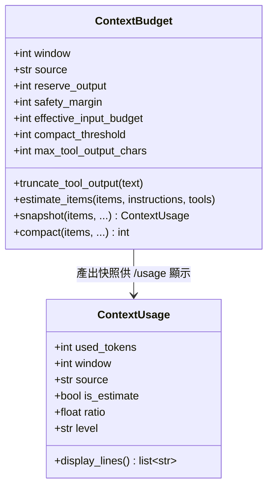
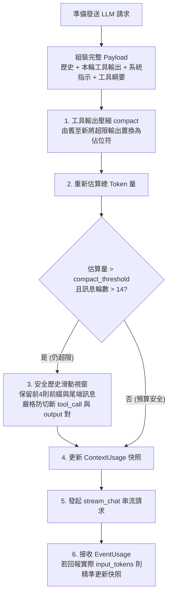

# Pocket Agent 上下文管理架構 (Context Budget Architecture)

在處理大型程式庫或長對話任務時，語言模型極易遭遇上下文長度超載 (Context Overflow) 或因輸出被隨意裁減而引發無效重讀的惡性循環。為此，Pocket Agent 建立了與模型供應商解耦的**上下文預算機制 (Context Budget)**，在維持對話脈絡完整性的同時，提供多層次的動態防護。

---

## 1. 核心設計架構與預算語意

上下文管理核心為 `pocket_agent.core.context_budget.ContextBudget`，其預算計算遵循嚴謹的可用輸入預算原則：

$$\text{可用輸入預算 (Effective Input Budget)} = \text{有效視窗} - \text{預留輸出空間} - \text{安全餘裕}$$



### 1.1 視窗來源優先級 (Window Resolution)

1. **使用者設定檔優先**：若在 `config.json` 或環境設定中指定 `system.context_window`，則以其為最高優先級，**不觸發**外部網路端點查詢。
2. **供應商引擎查詢**：呼叫 `engine.context_window()` 取得模型上限（如支援的供應商端點）。
3. **預設假設值 (Fallback)**：若皆未提供，採用保守假設值 `32,000` tokens（註：非絕對保底，若模型僅支援 4k/8k，可透過設定手動覆寫）。

### 1.2 預留空間與地板保護

- **預留輸出空間 (`reserve_output`)**：預設保留 4,096 tokens，確保模型具備足夠的生成空間，避免貼近邊界時報錯。
- **安全餘裕 (`safety_margin`)**：預設保留 1,024 tokens，以吸收 tokenizer 與 JSON 結構化傳遞過程中的誤差。
- **最低保底地板**：無論設定如何緊縮，可用輸入預算始終保證不小於 1,000 tokens。

---

## 2. 送出前統一管理流程 (Pipeline Sequence)

在 Agent 主迴圈 `_run_loop` 中，每一輪向 LLM 發出串流請求前，均會依序執行統一的上下文管理管線：



### 2.1 階段處置原則

1. **單筆輸出附加時截斷 (Append-time Truncation)**：
   工具執行完畢附加至訊息列表時，單筆輸出若超過預算的 8%（約視窗的 8%），立即進行一次性截斷，**嚴禁**事後原地重疊砍半。
2. **優先清除工具輸出 (Tool Compact)**：
   達到門檻（預算之 70%）時，優先將最舊的 `function_call_output` 替換為簡短佔位符，保留最近 2 筆輸出與所有對話原文。
3. **歷史滑動視窗保底 (History Sliding Window)**：
   僅在工具清除後仍超標時執行。裁減中間對話時，嚴密檢查邊界，確保不拆散成對的 `function_call` 與 `function_call_output`。

---

## 3. 工具邊界與檔案分頁防護

為防止單一工具（如 `read_file`）直接塞爆輸入預算，檔案系統工具層引入了雙重邊界防護：

- **行數上限**：未指定範圍時預設讀取最多 500 行。
- **字元數硬上限**：單次讀取上限嚴格限制為 **12,000 字元**。
- **超長單行防護**：針對混淆、壓縮的 JavaScript/JSON 等超長單行檔案，在字元數達到上限時立即安全截斷，並回傳明確的 `start_line` 續讀提示，引導模型採用分段方式閱讀。

---

## 4. 相關配置選項 (`config.json`)

使用者可在 `~/.pocket-agent/config.json` 的 `system` 區塊中進行以下微調：

```json
{
  "system": {
    "context_window": null, // 自訂 Context 視窗大小 (tokens)，例如 128000；null 則走自動解析
    "context_reserve_output": 4096, // 為模型生成預留的輸出 Token 空間
    "max_tool_rounds": 20 // 單次對話允許的最大工具呼叫輪數
  }
}
```
