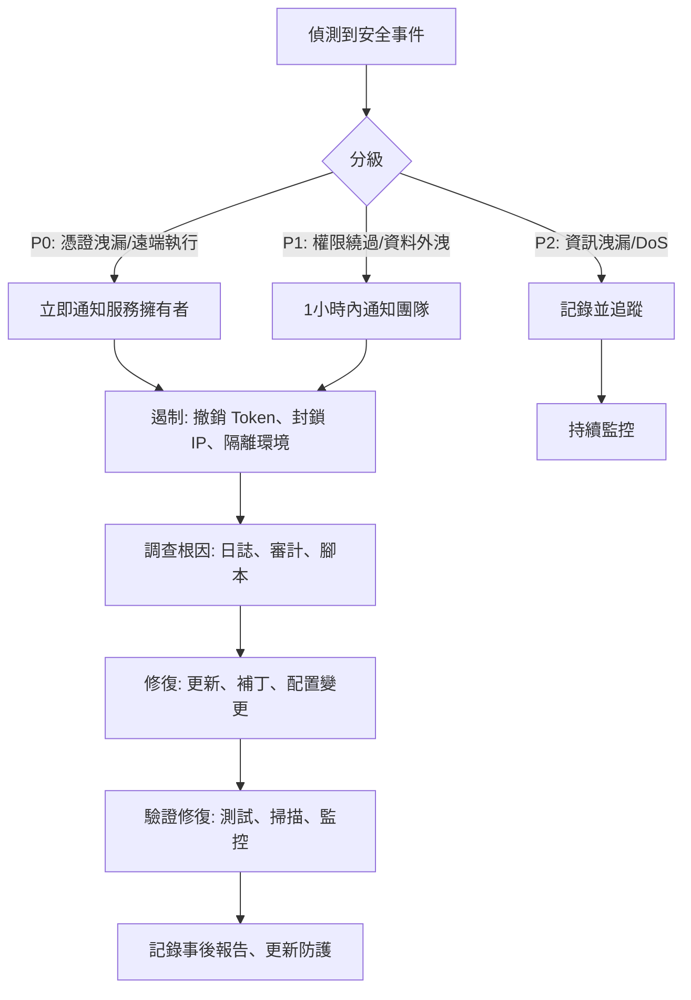

# PocketAgent 運維手冊

> **語系說明**：本文件語系遵循使用者提問語系（預設繁體中文）。若使用者以英文提問，請切換為英文輸出。

---

## 1. 服務概覽

| 項目         | 說明                                                                                     |
| ------------ | ---------------------------------------------------------------------------------------- |
| **服務名稱** | PocketAgent                                                                              |
| **版本**     | 0.1.0                                                                                    |
| **環境**     | 本機 CLI 應用 (Production / Development 同一執行檔)                                      |
| **部署方式** | Modern Portable (推薦) / 原始碼開發模式 / Legacy PyInstaller                             |
| **負責團隊** | PocketAgent 開發團隊                                                                     |
| **值班輪換** | N/A (本機工具，無中央服務)                                                               |
| **文件語系** | zh-TW                                                                                    |
| **最後更新** | 2025-01-20                                                                               |

---

## 2. 部署程序

### 2.1 標準部署流程

```mermaid
flowchart TD
    subgraph Portable["Modern Portable (推薦)"]
        Download[從 GitHub Releases 下載\nPocketAgent-portable.zip]
        Extract[解壓縮至任意目錄\n(如 D:\PocketAgent)]
        RunBat[雙擊 pocket.bat\n或 cmd 執行 pocket.bat]
        Setup[pocket-agent setup\n首次設定精靈]
        Use[開始使用]
    end

    subgraph Dev["開發模式"]
        Clone[git clone 專案]
        Venv[python -m venv venv]
        Activate[啟用虛擬環境]
        Install[pip install -r requirements.txt\npip install -e .]
        SetupDev[pocket-agent setup]
        RunDev[run.bat / run.sh / run.command]
    end

    subgraph Legacy["Legacy PyInstaller (不推薦)"]
        Build[build.bat 選擇 PyInstaller]
        ExeRun[執行 PocketAgent-cli.exe]
        Risk[防毒誤判風險高]
    end

    Download --> Extract --> RunBat --> Setup --> Use
    Clone --> Venv --> Activate --> Install --> SetupDev --> RunDev
    Build --> ExeRun --> Risk

    style Portable fill:#e8f5e9
    style Legacy fill:#ffebee
```

| 步驟 | 動作              | 指令/操作                                          | 驗證方式                              | 預估時間 |
| ---- | ----------------- | -------------------------------------------------- | ------------------------------------- | -------- |
| 1    | 下載 Portable 版  | 瀏覽器下載 `PocketAgent-portable.zip`              | 檔案存在、大小約 80-120 MB            | 1-5 分鐘 |
| 2    | 解壓縮            | 滑鼠右鍵「全部解壓縮」或 `tar -xzf`                | 出現 `PocketAgent/` 目錄含 `pocket.bat` | 30 秒    |
| 3    | 啟動              | 雙擊 `pocket.bat` 或 CMD 執行 `pocket.bat`         | 顯示 CLI 介面、版本資訊               | 5 秒     |
| 4    | 首次設定          | 輸入 `setup` 或 `pocket-agent setup`               | 完成 5 步驟精靈，生成 `config.json`   | 2-5 分鐘 |
| 5    | 連線驗證          | 輸入 `/usage` 或任意對話                           | 顯示 Token 用量、模型回應正常         | 10 秒    |

### 2.2 離線/氣隙環境部署

> **適用場景**：企業內網、無外網存取的生產環境、嚴格防火牆環境

#### 2.2.1 Modern Portable 離線部署

1. 在可連網的受信任環境準備核准的 `PocketAgent-portable.zip`、符合目標平台的 Ollama 安裝檔或既有服務，以及已預載的模型。Portable ZIP 包含 Python 與應用程式依賴，不包含 Ollama 或模型。依組織政策核對來源及檔案完整性後移轉。
2. 在目標機解壓縮至獨立目錄；依組織部署程序啟動已備妥的 Ollama。不要到離線機才執行需要下載的模型拉取操作。
3. 按[設定規格](configuration-specification.md)停用 `system.auto_update`，只掛載可達且經核准的 MCP 伺服器。執行 `pocket.bat`，在精靈選擇本機 Ollama 與已預載模型。預設端點為 `http://localhost:11434`。
4. 使用非敏感的短提示驗證模型回應，再測試需要的本機功能。雲端模型、OAuth、GitHub MCP 與線上更新需要相應的網路連線；MySQL、MSSQL、RHEL 與 RDP 若用於隔離內網，仍需能連到目標。SQLite 是本機資料庫，不需內網服務。

來源：[Portable 安裝與 Ollama 設定](../../README.md)、[Portable 打包程式](../../build_scripts/build_portable.py)。未在氣隙環境執行驗證；若以原始碼離線安裝，除執行依賴外，還需準備符合目標 OS、架構及 Python 版本的建置依賴與必要套件。

#### 2.2.2 依賴套件離線安裝 (開發模式)

| 生態系    | 離線準備指令 (有網路機器)                              | 離線安裝指令 (目標機器)                                                    |
| --------- | ------------------------------------------------------ | -------------------------------------------------------------------------- |
| **pip**   | `pip download -r requirements.txt -d ./wheelhouse`     | `pip install --no-index --find-links ./wheelhouse -r requirements.txt`     |
| **pip-tools** | `pip-compile requirements.in` → 複製 `requirements.txt` | 同上                                                                       |

#### 2.2.3 Windows 離線部署注意事項

- Modern Portable 內建官方簽章 `pythonw.exe`，**不需要**安裝 Python
- `pocket.bat` 設定 `PYTHONNOUSERSITE=1`、`PYTHONPATH=%~dp0app\src` 完全隔離
- 若端點防護攔截套件，先保留告警並核對來源與完整性，交由安全管理者審查；不要自行加入例外或關閉端點防護。
- 群組原則封鎖 PowerShell 時，`pocket.bat` 使用 `cmd.exe` 可正常運作

### 2.3 更新與回滾程序

| 觸發條件               | 更新指令         | 驗證方式              | 回滾方式                                      |
| ---------------------- | ---------------- | --------------------- | --------------------------------------------- |
| **Modern Portable**    | CLI 內建 `/update` | 重啟後核對建置 commit，執行基本功能檢查 | 關閉 CLI，將已知良好的 ZIP 解壓至另一個目錄；驗證後再切換，不先刪除原安裝 |
| **開發模式**           | `git pull` + `pip install -r requirements.txt` | 測試通過、功能正常 | `git checkout <舊commit>` + 重新安裝          |
| **PyInstaller Legacy** | 重新下載新版 exe  | 功能正常              | 保留舊版 exe 覆蓋回來                         |

> **注意**：Modern Portable 更新器追蹤設定的儲存庫與分支 commit，不一定是 `main`，也不等於 `v*` tag 的 Release。啟動時的背景作業只準備更新；固定版本或隔離環境可關閉 `system.auto_update`，由維護者佈署核准的 Release。來源：[更新器](../../src/pocket_agent/system/updater.py)、[CLI 啟動流程](../../src/pocket_agent/frontend/cli/main.py)、[發布流程](../../.github/workflows/release.yml)。

---

## 3. 災難恢復

### 3.1 備份策略

| 資料類型      | 備份頻率                | 保留期限              | 儲存位置                                               | 恢復指令                                      |
| ------------- | ----------------------- | --------------------- | ------------------------------------------------------ | --------------------------------------------- |
| **會話歷史**  | 每輪對話自動存檔        | 依 `/prune` 設定 (預設 30 天/保留 20 筆) | `~/.pocket-agent/sessions/*.json` (含 HMAC-SHA256)    | 複製檔案至同位置；`/session` 載入驗證         |
| **全域設定**  | 手動修改時              | 永久                  | `~/.pocket-agent/config.json`                          | 複製檔案覆蓋；`pocket-agent setup` 重新產生   |
| **MCP 設定**  | 手動修改時              | 永久                  | 專案根目錄 `mcp_config.yaml` / `~/.pocket-agent/mcp_config.yaml` | 複製檔案覆蓋                                  |
| **OAuth Token** | 自動 (Keyring/JWE)    | 永久 (Refresh 自動)   | OS Keyring / `~/.pocket-agent/encrypted_provider` (JWE) | `pocket-agent logout` 後重新 `setup`          |
| **工作區沙盒** | Housekeeping 自動清理  | 預設 7-28 天          | `~/.pocket-agent/workspaces/<slug>/`                   | 通常無需備份；重要筆記請手動複製至專案目錄    |
| **專案原始碼** | Git 提交時              | 永久                  | Git 遠端儲存庫                                         | `git clone`                                   |

### 3.2 恢復時間/點目標 (RTO/RPO)

| 層級         | RTO              | RPO              | 說明                                              |
| ------------ | ---------------- | ---------------- | ------------------------------------------------- |
| **核心功能** | 尚未實測 | 取決於最後一次可用設定備份 | 使用已知良好的 Portable ZIP 啟動，確認設定與供應商可用 |
| **會話歷史** | 尚未實測 | 取決於最後一次可還原的備份 | 同一環境備份會話與 `session_salt`；依下方說明驗證還原 |
| **MCP 連線** | 尚未實測 | 取決於可用設定及重新認證能力 | 執行期連線快取不是可還原的備份 |
| **完整環境** | 尚未實測 | 取決於最後一次成功的還原演練 | 由部署方量測並設定 RTO／RPO |

[會話簽章實作](../../src/pocket_agent/core/sessions.py)的驗證與 `session_salt`、主機名稱及登入使用者有關。請在原環境或核准的還原演練環境確認會話可載入；不能保證只複製 JSON 就能跨主機還原。發生簽章錯誤時先保留原檔，不要略過驗證。

### 3.3 常見災難場景與恢復

| 災難場景                 | 症狀                          | 恢復步驟                                                                     | 預估時間 |
| ------------------------ | ----------------------------- | ---------------------------------------------------------------------------- | -------- |
| **設定檔損毀**           | 啟動報錯、精靈無法讀取設定    | 1. 備份舊 `config.json` 2. 刪除或改名 3. 重新執行 `setup` 精靈              | 3 分鐘   |
| **Keyring 無法存取**     | OAuth 登入失敗、Token 讀取錯誤 | 1. `pocket-agent logout` 清除 2. 檢查 Keyring 服務 3. 重新 `setup` 登入     | 5 分鐘   |
| **會話檔案損毀／HMAC 失敗** | 會話無法載入或驗證失敗 | 先保留原始資料，核對還原環境與備份；無可驗證副本時另開會話 | 未實測 |
| **Portable 版執行檔損壞** | `pocket.bat` 報 Python 錯誤   | 1. 刪除 `PocketAgent/` 目錄 2. 重新解壓縮 zip 或下載新版                    | 3 分鐘   |
| **沙盒目錄佔滿磁碟**     | 寫入失敗、Housekeeping 失敗   | 1. 手動清理 `~/.pocket-agent/workspaces/` 2. 調整 `housekeeping_max_size_mb` | 5 分鐘   |
| **防毒軟體隔離執行檔**   | `pythonw.exe` 被隔離、無法啟動 | 保留告警，由安全管理者核對發布來源及完整性，依組織程序處理隔離項目                 | 10 分鐘  |

---

## 4. 疑難排解 (Troubleshooting)

### 4.1 常見問題速查表

| 症狀          | 可能原因                                    | 診斷指令/檢查                                    | 解決方案                                                    | 風險等級 |
| ------------- | ------------------------------------------- | ------------------------------------------------ | ----------------------------------------------------------- | -------- |
| **啟動即閃退** | Python 版本不符、依賴缺失、Portable 解壓不全 | `python --version`、查看 `agent.log` ERROR       | 確認 Python 3.14+、重新 `pip install -r requirements.txt`、重新解壓縮 | 高       |
| **OAuth 登入失敗** | 瀏覽器未開啟、Port 1455 被佔用、網路不通 | `netstat -an \| findstr 1455`、防火牆規則、瀏覽器彈窗攔截 | 手動開啟授權 URL、關閉佔用埠的程序、允許防火牆、關閉彈窗攔截 | 中       |
| **模型無回應/超時** | API 金鑰無效、額度耗盡、網路不穩、模型過載 | `/usage` 檢查額度、`agent.log` 連線錯誤、重試機制 | 更新 API Key、等待額度恢復、檢查網路、降低 `reasoning_effort` | 中       |
| **工具執行被攔截** | Default-Deny 政策、未在 safe_read_tools    | CLI 顯示 `[y/N]` 確認提示、`mcp_config.yaml` 白名單 | 加入 `safe_read_tools`、或輸入 `y` 確認、`A` 加入允許清單   | 低       |
| **檔案寫入失敗** | 權限不足、路徑不存在、Artifact 重導向       | `agent.log` WARNING/ERROR、檢查路徑、確認確認回呼 | 以管理員執行、確認路徑、輸入 `y`/`a`/`A` 允許              | 中       |
| **中文顯示亂碼** | 終端機編碼非 UTF-8、字體不支援              | `chcp 65001` (Windows)、終端機設定 UTF-8、安裝中文字體 | 設定終端機 UTF-8、使用支援中文的字體 (如 Cascadia Code)     | 低       |
| **MCP 連線失敗** | SSH/RDP/DB 參數錯誤、防火牆、服務未啟動     | `agent.log` `[ERROR]`、工具回傳錯誤訊息、手動測試連線 | 修正 `mcp_config.yaml` env、開放防火牆、啟動目標服務、重新輸入密碼 | 中       |
| **上下文超載** | `Context Overflow`、模型報 400 錯誤         | `/usage` 顯示 ratio > 90%、`agent.log` compaction 記錄 | 輸入 `/compact`、調大 `context_window`、減少附件/工具輸出   | 高       |
| **子代理卡住** | 無限迴圈、等待確認、網路逾時                | `agent.log` DivergenceGuard 警告、Ctrl+C 中斷   | Ctrl+C 強制中斷、檢查任務描述是否明確、調整 `max_tool_rounds` | 中       |

### 4.2 關鍵日誌位置

| 日誌類型     | 路徑/查詢方式                                                    | 保留期限                 | 關鍵字過濾                                   |
| ------------ | ---------------------------------------------------------------- | ------------------------ | -------------------------------------------- |
| **應用日誌** | `~/.pocket-agent/workspaces/<slug>/logs/agent_YYYY-MM-DD.log`    | 14 天 (Housekeeping)     | `ERROR`, `WARN`, `Context Overflow`, `mcp`   |
| **MCP Stdio** | `~/.pocket-agent/workspaces/<slug>/logs/mcp_stdio.log`          | 14 天                    | `ERROR`, `Connection closed`, `auth`         |
| **系統日誌** | Windows: 事件檢視器 / Linux: `journalctl -u <service>`          | 系統預設                 | `python`, `pocket-agent`                     |
| **審計日誌** | 會話 JSON 內含 HMAC、操作記錄                                     | 依 `/prune` (預設 30 天) | `hmac`, `signature`, `tool_call`             |

> **查看日誌實用指令**：
>
> ```cmd
> :: Windows CMD
> type ~/.pocket-agent/workspaces/*/logs/agent_*.log | findstr "ERROR"
> type ~/.pocket-agent/workspaces/*/logs/agent_*.log | findstr "WARN"
> 
> :: PowerShell (若可用)
> Get-Content ~/.pocket-agent/workspaces/*/logs/agent_*.log | Select-String "ERROR"
> ```

### 4.3 關鍵指標與健康檢查

| 指標           | 正常範圍          | 異常處理                          |
| -------------- | ----------------- | --------------------------------- |
| **啟動時間**   | < 3 秒            | > 10 秒檢查依賴、防毒軟體         |
| **模型回應延遲** | < 30 秒 (視模型)  | > 60 秒檢查網路、降低 reasoning   |
| **工具執行成功率** | > 95%           | 連續失敗檢查 `agent.log`、MCP 連線 |
| **上下文使用率** | < 80%            | > 90% 觸發 `/compact` 或調整設定   |
| **會話檔案數** | < 50              | > 100 執行 `/prune`               |
| **沙盒目錄大小** | < 500 MB         | > 1 GB 手動清理、調整 housekeeping |

---

## 5. 維護作業

### 5.1 例行維護排程

| 作業        | 頻率             | 執行窗口           | 指令/步驟         | 負責人            | 影響範圍           |
| ----------- | ---------------- | ------------------ | ----------------- | ----------------- | ------------------ |
| Housekeeping 自動清理 | 每 24 小時     | 應用啟動時         | 自動 (無需手動)   | 系統              | 沙盒目錄           |
| Session Prune | 視需求 (手動)   | 使用者決定         | `/prune`          | 使用者            | 會話歷史           |
| 依賴更新檢查 | 每月            | 維護窗口           | `pip-compile --upgrade` | 開發團隊       | requirements.txt   |
| 安全掃描     | 每月 / Release 前 | 維護窗口           | `pip-audit`、`bandit` | 開發團隊       | 相依套件、原始碼   |

### 5.2 版本升級檢查清單

- [ ] 變更日誌審閱 (Breaking Changes)
- [ ] 相依性安全掃描 (`pip-audit`, `bandit`)
- [ ] 設定檔相容性檢查 (`config-schema.json`)
- [ ] 整合測試全數通過 (`pytest tests/`)
- [ ] 格式與靜態分析通過 (`ruff format --check .`, `ruff check .`)
- [ ] 匯入完整性檢查 (`scripts/check_imports.py src scripts`)
- [ ] 手動驗證：CLI 啟動、設定精靈、基本對話、MCP 連線
- [ ] 回滾方案確認 (保留舊版 zip / git tag)
- [ ] 文件更新 (README、架構文件、運維手冊)

---

## 6. 安全事件應變

### 6.1 通報流程



### 6.2 應變等級定義

| 等級   | 定義       | 響應時間        | 升級條件          | 指揮官           |
| ------ | ---------- | --------------- | ----------------- | ---------------- |
| **P0** | 憑證洩漏、RCE、大規模資料外洩 | 立即 (15 分鐘內) | 任何實際入侵跡象 | 服務擁有者       |
| **P1** | 權限繞過、敏感資料存取、服務中斷 | 1 小時內         | 影響擴大、多用戶受影響 | 技術負責人       |
| **P2** | 資訊洩漏、DoS 嘗試、異常行為 | 4 小時內         | 重複發生、規律性 | 值班工程師       |

### 6.3 關鍵安全操作

| 操作                  | 指令/步驟                                                              |
| --------------------- | ---------------------------------------------------------------------- |
| **撤銷 OAuth Token**  | `pocket-agent logout` (清除 Keyring/JWE)；供應商 Dashboard 撤銷       |
| **撤銷 MCP 憑證**     | 刪除 `mcp_config.yaml` 相關 `env`/`inject`；目標系統撤銷 API Key/密碼 |
| **清除會話歷史**      | 刪除 `~/.pocket-agent/sessions/*.json` (含 HMAC)                       |
| **重置全域設定**      | 刪除 `~/.pocket-agent/config.json`、重新 `setup`                       |
| **封鎖可疑網路連線**  | Windows 防火牆規則 / Linux `iptables` / 企業級 WAF                     |

---

## 7. 連絡資訊

| 角色           | 姓名            | 電話             | Email            | Slack/Teams      | 備援聯絡人        |
| -------------- | --------------- | ---------------- | ---------------- | ---------------- | ----------------- |
| **服務擁有者** | PocketAgent Team | -                | `team@pocket-agent.dev` | #pocket-agent | -                 |
| **值班工程師** | -               | -                | -                | #pocket-agent-oncall | -              |
| **資安團隊**   | -               | -                | `security@pocket-agent.dev` | #security    | -                 |

---

## 8. 運維流程圖

```mermaid
flowchart TB
    subgraph Daily["日常運維"]
        Start[啟動 PocketAgent] --> HealthCheck{健康檢查\n/usage 正常?}
        HealthCheck -- 是 --> Monitor[監控日誌、指標]
        HealthCheck -- 否 --> Troubleshoot[疑難排解流程]
        Monitor --> Housekeeping[Housekeeping 自動執行]
        Housekeeping --> End[正常運作]
        Troubleshoot --> Fix[修復/升級/回滾]
        Fix --> HealthCheck
    end

    subgraph Incident["事件處理"]
        Alert[告警觸發] --> Triage{分級}
        Triage -- P0 --> P0Flow[P0 流程: 立即響應]
        Triage -- P1 --> P1Flow[P1 流程: 1小時內]
        Triage -- P2 --> P2Flow[P2 流程: 4小時內]
        P0Flow --> Contain[遏制損害]
        P1Flow --> Contain
        P2Flow --> Contain
        Contain --> RootCause[根因分析]
        RootCause --> Fix[修復驗證]
        Fix --> Postmortem[事後報告]
    end

    subgraph Release["發布流程"]
        Tag[推送 v* Tag] --> CI[GitHub Actions CI]
        CI --> Build[建置 Portable]
        Build --> Release[GitHub Release]
        Release --> Verify[驗證下載、安裝、啟動]
        Verify --> Announce[通知使用者]
    end
```

---

## 9. 變更記錄

| 版本        | 日期     | 作者       | 變更摘要 |
| ----------- | -------- | ---------- | -------- |
| 0.1.0       | 2025-01-20 | PocketAgent Team | 初版建立 (由 generate-system-docs 自動生成) |
