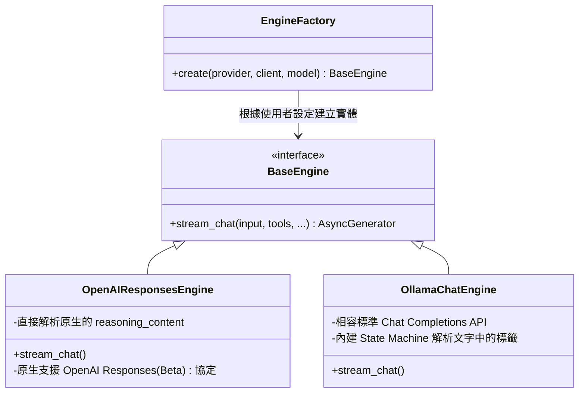

# Pocket Agent 雙軌大模型轉接架構 (LLM Engine Adapter)

為了解決不同 LLM 提供者（如 OpenAI 與 Ollama）在 API 規格與進階功能（例如 Reasoning 推理過程）上的差異，Pocket Agent 採用了 **Adapter Pattern (轉接器模式)**，將底層的模型通訊抽象化，確保上層介面（GUI / CLI）能無縫切換並統一處理。

## 架構設計視覺化

系統透過 `EngineFactory` 動態決定要實例化哪一種引擎，所有引擎皆實作 `BaseEngine` 介面，並以統一的 AsyncGenerator 事件流（`EventText`, `EventThinking`, `EventToolCallStart` 等）回傳給核心控制迴圈。



## `<think>` 標籤狀態機剖析機制 (State Machine)

OpenAI 最新模型原生支援分開的推理區塊（Reasoning Content），但本地端的開源模型（例如 DeepSeek-R1）通常是將思考過程用 `<think>...</think>` 標籤包裹，直接混在純文字回覆中一併串流 (Streaming) 回傳。

為此，`OllamaChatEngine` 內建了一個**串流狀態機 (Streaming State Machine)**。此機制會在接收到每一小塊 (chunk) 文字時即時剖析，將思考內容與正式回覆剝離，使得 GUI 能夠將本機模型的思考過程，優雅地折疊進專屬的思考面板中，不會污染主對話視窗。

```mermaid
flowchart TD
    Chunk[接收 LLM Streaming Chunk] --> IsInThink{目前是否在思考狀態?<br>in_think_block}

    IsInThink -- 否 (False) --> CheckThinkStart{文字包含 &lt;think&gt; 嗎?}
    CheckThinkStart -- 是 --> YieldTextBefore[送出 &lt;think&gt; 前的正式文字]
    YieldTextBefore --> SetThinkTrue[切換至思考狀態 (True)]
    SetThinkTrue --> ProcessThinkData[處理剩下的思考內容]
    CheckThinkStart -- 否 --> YieldText[送出 EventText (正式文字)]

    IsInThink -- 是 (True) --> CheckThinkEnd{文字包含 &lt;/think&gt; 嗎?}
    CheckThinkEnd -- 是 --> YieldThinkBefore[送出 &lt;/think&gt; 前的思考文字]
    YieldThinkBefore --> SetThinkFalse[切換回正式狀態 (False)]
    SetThinkFalse --> ProcessTextData[處理剩下的正式內容]
    CheckThinkEnd -- 否 --> YieldThink[送出 EventThinking (思考文字)]
```

## 關鍵優勢

1. **無縫切換**：使用者可透過 `/model` 指令即時切換線上 (OpenAI) 或離線 (Ollama) 模型，上層的渲染邏輯與工具呼叫邏輯完全不需修改。
2. **平滑相容**：無論底層是否原生支援分離式的 Reasoning 欄位，轉接器都會將其統一收斂為 `EventThinking` 事件，確保跨模型的使用者體驗一致。
3. **擴充性高**：未來若有新的 API 供應商（如 Anthropic 或 Google Gemini），只需新增對應的 Engine 類別實作 `BaseEngine`，不需修改核心流程。
