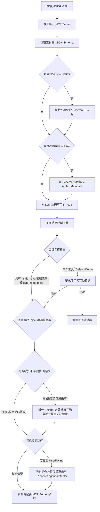

# Pocket Agent MCP 伺服器掛載與注入機制

Model Context Protocol (MCP) 是標準化的 AI 工具橋接協定。Pocket Agent 實作了強健的 MCP Manager（`src/pocket_agent/extensions/mcp.py`），除了支援標準的 Stdio 與 SSE 傳輸層外，更加入了**機密金鑰注入**與**沙盒隔離**兩大企業級安全機制。

## 架構與安全攔截機制視覺化

## 核心機制解析

### 1. 自動注入與 Schema 抹除機制 (Security Inject)

當我們串接外部 MCP Server（例如資料庫查詢、API 操作）時，經常需要提供敏感的 API Key 或連線字串。
如果直接將這些欄位暴露在 Tool Schema 中，模型可能會「試圖」填寫，或者我們必須在系統提示詞中明碼寫出金鑰，這存在極大的資安風險。

Pocket Agent 的解決方案：

- 在 `mcp_config.yaml` 的 `inject` 區段設定金鑰。
- **註冊階段**：`MCPManager` 會自動攔截 Server 回報的 JSON Schema，將 `inject` 指定的參數**從 Schema 中徹底抹除**，因此 LLM 根本不知道有這個參數的存在。
- **執行階段**：當 LLM 呼叫該工具時，`MCPManager` 會在底層自動將 `inject` 參數合併回 Payload 中，再送交給 MCP Server 執行。實現「模型免接觸、伺服器能授權」的安全架構。

### 2. Artifact 全域隔離機制

為防止 AI 的自主行為污染使用者本地端的工作區程式碼，Pocket Agent 針對所有具備檔案寫入能力的工具（如 `write_to_file`, `write_file`, `create_file`）進行了強制攔截：

- **動態 Schema 擴充**：系統會在註冊階段強制要求這些工具必須帶有 `ArtifactMetadata` 參數，強制 LLM 交代寫入檔案的目的與是否面向使用者 (`UserFacing`)。
- **路徑重導向 (Redirect)**：在執行階段，若判斷為產出物，系統會無視 LLM 給予的路徑，強制將目標路徑替換到 `~/.pocket-agent/artifacts/<filename>`，確保沙盒外的專案原始碼安全無虞。

### 3. 工具授權與 `safe_read_tools` 白名單策略

為了防止惡意或未預期的 MCP 工具執行破壞性操作，Pocket Agent 實作了預設拒絕 (Default-Deny) 授權模型：

- **白名單自動放行**：工具名稱帶有特定前綴（如 `_safe_read`），或在 `mcp_config.yaml` 的伺服器設定中明確列於 `safe_read_tools` 清單內的唯讀安全工具（系統會在 Schema 標記 `"_is_safe_read": True`），在被 LLM 呼叫時會自動放行執行。
- **未知工具攔截**：對於所有未在白名單內或不具備安全標記的工具，系統預設視為高風險操作。當 LLM 試圖呼叫這些工具時，執行緒會被暫停，並在 CLI 介面強制要求使用者互動確認 (`[y/N]`)。若使用者拒絕，該次工具呼叫會被直接攔截並回傳錯誤給 LLM，保障系統安全。

### 4. 彈性連線參數配置與執行期互動詢問機制

針對需要遠端連線憑證的 MCP 工具（例如 `rhel_mcp.py` 支援的 `ssh_host`、`ssh_port`、`ssh_user`、`ssh_password` 內部參數，對應環境變數 `RHEL_HOST`、`RHEL_SSH_PORT`、`RHEL_SSH_USER`、`RHEL_SSH_PASSWORD`），`MCPManager` 提供兼顧便利性與零落盤安全的混合解析機制：

1. **Schema 自動隱藏**：註冊工具時，`MCPManager` 會自動將 `ssh_host`、`ssh_port`、`ssh_user`、`ssh_password` 從公開給 LLM 的 JSON Schema 中抹除，確保模型不會看到或嘗試猜測連線資訊與密碼。
2. **設定檔與環境變數優先**：執行工具時，依序檢查 `mcp_config.yaml` 的 `env` 設定、當次 Session 記憶體快取（`_runtime_conn_cache`）與系統環境變數。已設定且非空白的項目會直接使用。
3. **缺漏項目動態詢問（`on_prompt_conn`）**：若任何一項連線參數留空字串 `""` 或直接省略，`MCPManager` 會在首次呼叫工具前觸發前端回呼（CLI 會安全暫停 `rich.status` 動畫後透過 `Prompt.ask` 詢問，其中密碼強制使用 `password=True` 隱藏輸入；若無前端回呼則由 MCP Server 透過系統底層 TTY `CONIN$`／`/dev/tty` 詢問）。
4. **記憶體快取與失敗自動清除**：詢問取得的連線資訊僅暫存於當次執行期的記憶體中，同一對話後續呼叫無需重複輸入；一旦工具回傳 `[ERROR]`（例如認證失敗或連線逾時），系統會自動清除記憶體快取，以便下次重新提示輸入。所有敏感欄位在 `agent.log` 除錯日誌中一律遮罩為 `***REDACTED***`。

---

## 內建 RHEL 遠端巡檢與維運伺服器 (`mcp_servers/rhel_mcp.py`)

`rhel_mcp.py` 為內建的遠端 Red Hat Enterprise Linux (RHEL) 結構化唯讀巡檢與維運支援伺服器，支援原始碼開發模式、Portable 免安裝版與 PyInstaller 單一執行檔（`PocketAgent-cli.exe --internal-mcp-server`）跨目錄啟動。

### 1. 提供的結構化工具清單

所有工具均為唯讀操作，不會在遠端主機執行任何狀態修改，建議於 `mcp_config.yaml` 中加入 `safe_read_tools`：

| 工具名稱               | 用途說明                                                                 | 工具參數（供 LLM 呼叫）                                                                  |
| :--------------------- | :----------------------------------------------------------------------- | :--------------------------------------------------------------------------------------- |
| `rhel_system_overview` | 取得發行版資訊 (`/etc/os-release`)、Kernel、Uptime、CPU/Load、記憶體與失敗的 systemd 單元 | 無                                                                                       |
| `rhel_storage_and_fs`  | 檢查區塊裝置 (`lsblk`)、檔案系統空間 (`df -hT`)、Inodes (`df -i`) 與掛載配置 | 無                                                                                       |
| `rhel_network_status`  | 檢查網路介面 (`ip -br addr`)、路由表 (`ip route`)、監聽埠 (`ss -tulnp`) 與 DNS | 無                                                                                       |
| `rhel_service_status`  | 查詢指定 systemd 服務的狀態 (`systemctl status`) 與單元設定               | `service_name`（必填，嚴格限制為合法單元名稱 `[a-zA-Z0-9_.@-]+`）                         |
| `rhel_query_journal`   | 查詢 `journalctl` 系統或特定服務日誌                                     | `unit`（選填）、`priority`（預設 `err`）、`since`（預設 `1 hour ago`）、`lines`（1~200） |
| `rhel_security_status` | 檢查 SELinux 狀態 (`getenforce`/`sestatus`)、Firewalld 與近期失敗登入紀錄 | 無                                                                                       |
| `rhel_read_config`     | 唯讀檢視白名單目錄下的設定檔內容（最多 200 行，自動遮罩機密欄位）         | `path`（必填，僅限 `/etc/`、`/usr/lib/systemd/system/`、`/proc/sys/` 下的檔案）          |

### 2. 安全防禦邊界

- **強制純帳號密碼驗證（無金鑰／Agent 後門）**：底層透過系統 `ssh`（搭配 `SSH_ASKPASS_REQUIRE=force` 暫存腳本）或 Windows PuTTY `plink -pw -noagent` 連線，並強制附加 `-o PubkeyAuthentication=no`、`-o GSSAPIAuthentication=no`、`-o IdentitiesOnly=yes`、`-o IdentityAgent=none` 與 `-o PreferredAuthentications=keyboard-interactive,password`，徹底停用公私鑰、SSH Agent 與 Kerberos 驗證管道。
- **零任意 Shell 執行與參數防注入**：不提供通用 `run_command` 工具；所有遠端指令皆為固定模板，且外部參數皆經過嚴格正規表示式驗證與 `shlex.quote` 轉義。
- **設定檔路徑白名單與黑名單**：`rhel_read_config` 透過 `realpath -e` 解析真實路徑，僅允許讀取 `/etc/`、`/usr/lib/systemd/system/`、`/proc/sys/`，並強制攔截 `/etc/shadow`、`/etc/gshadow`、`/etc/sudoers`、`*.key`、`*.pem`、`id_rsa` 等敏感檔案。
- **敏感資訊遮罩與輸出截斷**：回傳結果自動將 `password`、`secret`、`token`、`api_key` 等賦值或設定行替換為 `***REDACTED***`，並限制單次輸出上限為 `12,000` 字元。

### 3. 環境變數與配置參數表 (`env`)

可於 `mcp_config.yaml` 的 `servers.rhel_ops.env` 中設定：

| 參數名稱               | 必填 / 選填 | 預設值   | 空白或省略時的行為                                             | 說明                                                                                     |
| :--------------------- | :---------- | :------- | :------------------------------------------------------------- | :--------------------------------------------------------------------------------------- |
| `RHEL_HOST`            | 彈性        | `""`     | 首次呼叫工具時於終端機互動詢問目標主機 IP 或 Hostname          | 目標 RHEL 主機的 IP 位址或網域名稱。                                                     |
| `RHEL_SSH_PORT`        | 彈性        | `"22"`   | 若省略或留空，首次呼叫工具時於終端機互動詢問（預設帶入 `22`）   | 目標 RHEL 主機的 SSH 連接埠（`1` ~ `65535`）。                                           |
| `RHEL_SSH_USER`        | 彈性        | `""`     | 首次呼叫工具時於終端機互動詢問登入帳號                         | 登入遠端主機的 SSH 使用者帳號。                                                          |
| `RHEL_SSH_PASSWORD`    | 彈性        | `""`     | 首次呼叫工具時於終端機以隱藏輸入（不回顯）方式詢問登入密碼     | 登入遠端主機的 SSH 密碼。建議留空或省略，於對話執行期動態輸入以確保設定檔不落盤明文密碼。 |
| `RHEL_CONNECT_TIMEOUT` | 選填        | `"10"`   | 套用預設值 `10` 秒                                             | SSH 連線逾時秒數。                                                                       |
| `RHEL_STRICT_HOST_KEY` | 選填        | `"false"`| 套用預設值 `"false"`（自動接受新主機金鑰，避免首次連線中斷）   | 設為 `"true"`、`"1"` 或 `"yes"` 時啟用嚴格的 `StrictHostKeyChecking=yes` 檢查。          |
| `RHEL_PLINK_PATH`      | 選填        | 自動偵測 | 自動搜尋 `PATH` 與常見 PuTTY 安裝路徑                          | 選用的 PuTTY `plink.exe` 執行檔路徑（作為系統 OpenSSH 的備援連線工具）。                 |
