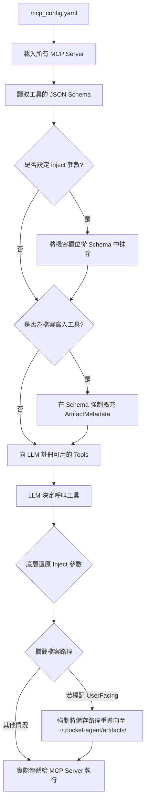

# Pocket Agent MCP 伺服器掛載與注入機制

Model Context Protocol (MCP) 是標準化的 AI 工具橋接協定。Pocket Agent 實作了強健的 MCP Manager（`src/pocket_agent/extensions/mcp.py`），除了支援標準的 Stdio 與 SSE 傳輸層外，更加入了**機密金鑰注入**與**沙盒隔離**兩大企業級安全機制。

## 架構與安全攔截機制視覺化

## 核心機制解析

### 1. 自動注入與 Schema 抹除機制 (Security Inject)

當我們串接外部 MCP Server（例如資料庫查詢、API 操作）時，經常需要提供敏感的 API Key 或連線字串。
如果直接將這些欄位暴露在 Tool Schema 中，模型可能會「試圖」填寫，或者我們必須在系統提示詞中明碼寫出金鑰，這存在極大的資安風險。

Pocket Agent 的解決方案：

- 在 `mcp_config.yaml` 的 `inject` 區段設定金鑰。
- **註冊階段**：`MCPManager` 會自動攔截 Server 回報的 JSON Schema，將 `inject` 指定的參數**從 Schema 中徹底抹除**，因此 LLM 根本不知道有這個參數的存在。
- **執行階段**：當 LLM 呼叫該工具時，`MCPManager` 會在底層自動將 `inject` 參數合併回 Payload 中，再送交給 MCP Server 執行。實現「模型免接觸、伺服器能授權」的安全架構。

### 2. Artifact 全域隔離機制

為防止 AI 的自主行為污染使用者本地端的工作區程式碼，Pocket Agent 針對所有具備檔案寫入能力的工具（如 `write_to_file`, `write_file`, `create_file`）進行了強制攔截：

- **動態 Schema 擴充**：系統會在註冊階段強制要求這些工具必須帶有 `ArtifactMetadata` 參數，強制 LLM 交代寫入檔案的目的與是否面向使用者 (`UserFacing`)。
- **路徑重導向 (Redirect)**：在執行階段，若判斷為產出物，系統會無視 LLM 給予的路徑，強制將目標路徑替換到 `~/.pocket-agent/artifacts/<filename>`，確保沙盒外的專案原始碼安全無虞。
