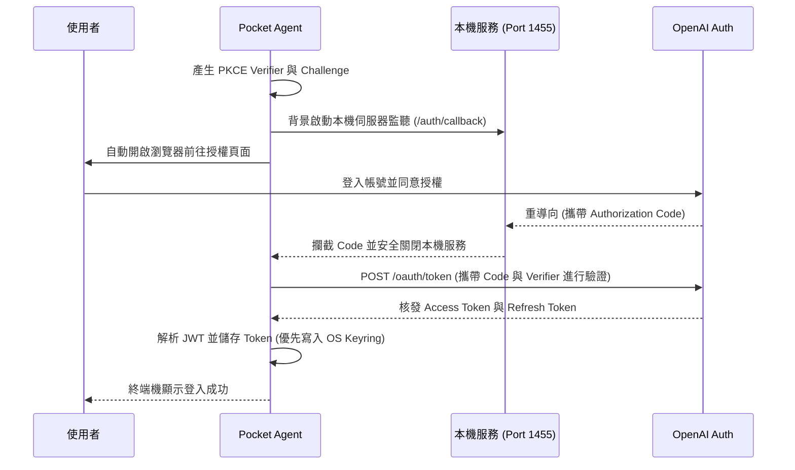

# Pocket Agent ChatGPT OAuth 2.0 認證機制

本專案（主要實作於 `agent/auth.py`）採用了 **OAuth 2.0 PKCE (Proof Key for Code Exchange)** 授權流程來處理 ChatGPT 的登入。

這套機制不需要在程式碼中寫死 Client Secret，能有效防止憑證外洩，是原生桌面應用程式或 CLI 工具中最安全、也是業界標準的作法。

## 執行流程視覺化

以下為系統取得授權的循序圖（Sequence Diagram）：

## 關鍵架構與實作細節

1. **PKCE 防護 (Proof Key for Code Exchange)**
   在每次登入要求前，系統會動態產生一組 `code_verifier`，並將雜湊後的 `code_challenge` 送交 OpenAI 進行授權。在最後階段交換 Token 時，必須再次核對 `code_verifier`。此機制能有效防止惡意程式在作業系統中攔截授權碼。

2. **本機回呼路由 (Local Callback)**
   利用 `FastAPI` 搭配 `uvicorn` 建立臨時伺服器（預設監聽 `localhost:1455`），專門接收 OAuth 授權完成後的重導向參數。透過 Thread 進行無阻擋（Non-blocking）管理，在收到授權碼或逾時後會自動安全關閉。

3. **憑證安全儲存機制**
   優先呼叫作業系統原生的金鑰圈（例如 Windows Credential Manager, macOS Keychain）透過 `keyring` 套件來加密儲存 Token，確保最高層級的安全性。若執行環境不支援原生金鑰圈，系統會優雅降級，將 Token 寫入 `~/.pocket-agent/token.json`。

4. **自動展期與續用 (Auto Refresh)**
   系統實作了自動展期機制。當應用程式發出請求時，若偵測到當前 Access Token 即將過期（剩餘時間小於 60 秒），便會自動透過 `refresh_token` 向 OpenAI 換發新憑證，確保背景排程與連續對話不會因 Token 過期而中斷。
