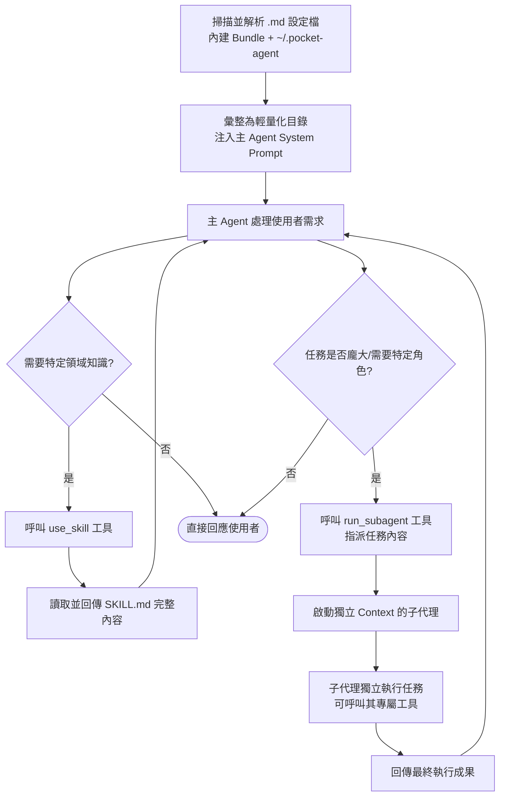

# Pocket Agent 工具呼叫與 Subagent 委派機制

為了解決複雜任務導致單一 Prompt 過長（Context 壅塞）以及 AI 角色混亂的問題，Pocket Agent 實作了基於 Markdown 的 **Skills (操作手冊)** 與 **Subagents (子代理)** 雙重抽象層。

這套機制能夠讓模型在需要時「動態查閱 SOP」或「將特定任務外包給具備專屬人設的代理」，而非將所有資訊硬塞在最初的系統提示詞中。

## 雙重委派機制視覺化

## 核心機制解析

### 1. Skills 知識包機制 (`use_skill`)

Skill 的本質是「操作手冊」或「規範文件」，而不是可執行的程式。

- **儲存格式**：以 Markdown 撰寫（帶有 YAML Frontmatter 定義 `name` 與 `description`）。
- **目錄引導**：系統在啟動時，只會把 Skill 的「名稱與一句話描述」做成目錄，塞進主 Agent 的系統提示詞。
- **按需載入 (On-Demand Loading)**：當 LLM 判斷當前任務需要遵循某項規範（如程式碼審查標準、週報格式）時，會主動呼叫 `use_skill` 工具。該工具會讀取 `.md` 原文並作為上下文回傳，LLM 接著再根據這份規範執行任務。此設計大幅節省了平時不必要的 Token 消耗。

### 2. Subagents 子代理委派 (`run_subagent`)

當面臨需要不同思維模式（例如：資料分析師、測試工程師）或避免主對話過度冗長的任務時，系統會委派給 Subagent 處理。使用者也可以直接透過 CLI 捷徑強制觸發。

- **CLI 動態捷徑與 Zero-Token 路由**：除了主 Agent 自行決定外，使用者可直接輸入 `/subagent <name>`，或利用動態捷徑 `/<name>` (例如 `/researcher`)，強制將任務交辦給指定的子代理。此操作會**在系統層被攔截並直接啟動子代理**，跳過主代理的 LLM 推理，達成 Zero-Token 的極速分派。
- **獨立的狀態與人設**：Subagent 的 `.md` 檔案定義了完全不同的 System Prompt。當 `run_subagent` 或是 CLI 捷徑被觸發時，系統會在背景啟動一個**全新且獨立的 LLM Session**。
- **乾淨的 Context**：子代理看不到主對話的歷史，只會看到主 Agent 交辦的 `task` 描述。這強迫主 Agent 必須像人類主管一樣，清晰地定義任務範圍與驗收標準。
- **進度串流 (Stream Forwarding)**：雖然子代理在隔離環境運行，但其思考過程 (Thinking) 與工具呼叫會加上專屬前綴 (例如 `[researcher]`) 並即時串流至使用者的 CLI 介面，兼顧 Context 隔離與操作可視性。
- **資源隔離**：在架構設計上，子代理執行時不會觸發全域的 Hooks，也不能無限遞迴再開子代理（防止失控無限展開）。當子代理完成工作後，只會將總結結果回傳給主 Agent，確保主對話的上下文極度乾淨且專注。
